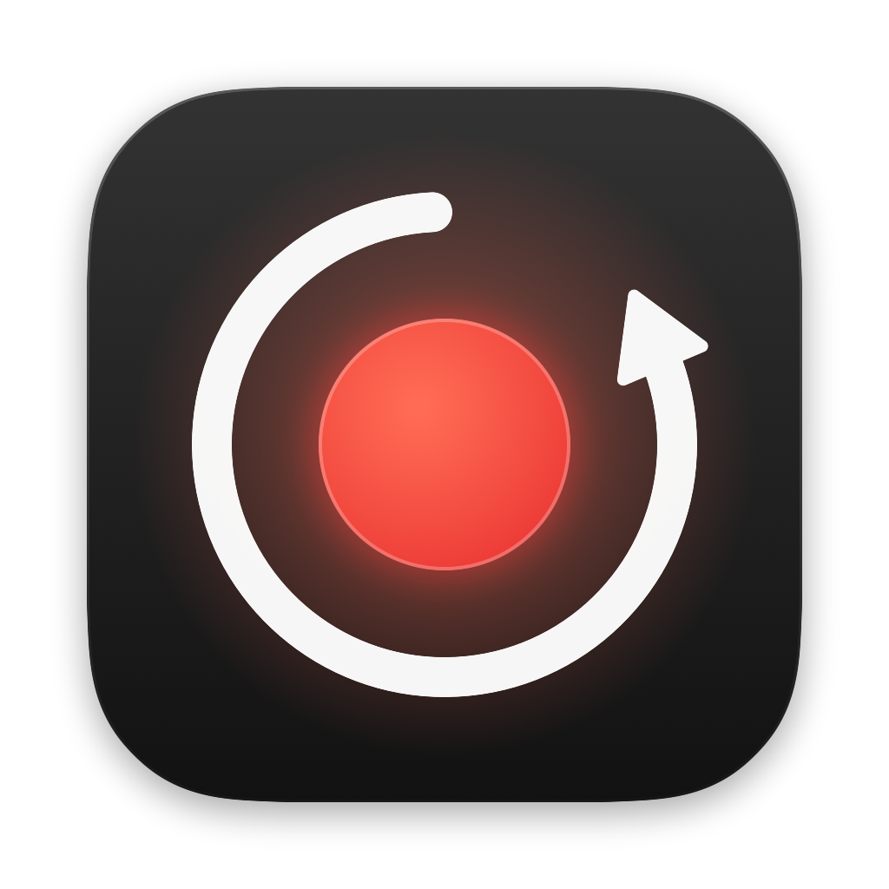
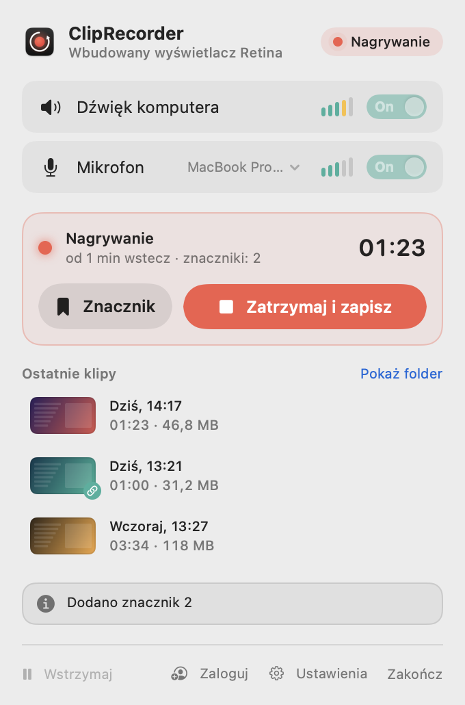
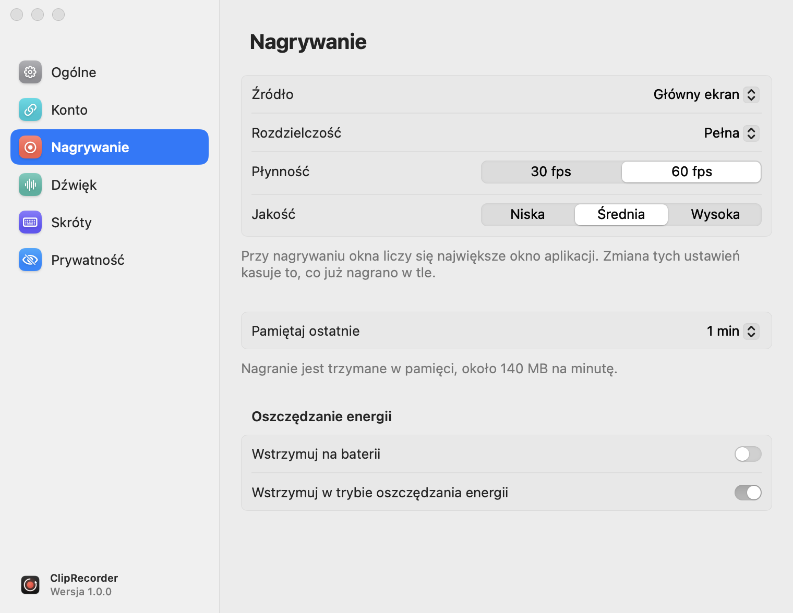

<p align="center">
  
</p>

<h1 align="center">ClipRecorder</h1>

<p align="center">
  Nagrywanie „ostatniej minuty” ekranu na macOS – jak instant replay w grach, tylko dla całego Maca.<br>
  <i>A macOS menu bar app that keeps a rolling buffer of your screen, system audio and microphone and saves the last minute with a hotkey.</i>
</p>

<p align="center">
  <a href="https://github.com/ItsRaelx/ClipRecorder/releases/latest">Pobierz</a> ·
  <a href="docs/README.md">Dokumentacja</a> ·
  <a href="docs/problemy.md">Pomoc</a>
</p>

<picture>
  <source media="(prefers-color-scheme: dark)" srcset="docs/screenshots/hero-dark.png">
  
</picture>

## Jak to działa

ClipRecorder siedzi w pasku menu i cały czas pamięta ostatnią minutę (albo od 30 s do 10 min) tego, co dzieje się
na ekranie, razem z dźwiękiem komputera i mikrofonem. Wydarzyło się coś ciekawego? Naciskasz skrót i klip zawiera
to, co **już minęło**.

| Skrót (domyślnie) | Działanie |
|---|---|
| <kbd>⌃</kbd><kbd>⌥</kbd><kbd>R</kbd> | zapisuje ostatnie N s **i nagrywa dalej**, a drugie naciśnięcie kończy klip |
| <kbd>⌃</kbd><kbd>⌥</kbd><kbd>S</kbd> | od razu zapisuje **tylko** ostatnie N s |
| <kbd>⌃</kbd><kbd>⌥</kbd><kbd>M</kbd> | w trakcie nagrywania dodaje znacznik (rozdział w pliku) |

Skróty działają wszędzie, także w grach i na pełnym ekranie, i można je zmienić w ustawieniach.

## Funkcje

<table>
<tr>
<td width="50%" valign="top">

**Nagrywanie w tle**
- bufor 30 s – 10 min (do 2 min w pamięci, dłuższy na dysku)
- wideo HEVC kodowane sprzętowo, 30/60 fps, do natywnej rozdzielczości
- cały ekran, wybrany monitor albo okno aplikacji
- wybrane aplikacje (np. menedżer haseł) ukryte w nagraniu
- znaczniki zapisywane jako rozdziały

**Dźwięk**
- osobne ścieżki *Dźwięk systemu* i *Mikrofon* do montażu
- domyślna ścieżka *Miks* z regulacją głośności i ogranicznikiem
- tryb automatyczny omija mikrofony Bluetooth, więc muzyka w AirPodsach nie traci jakości

</td>
<td width="50%" valign="top">

<picture>
  <source media="(prefers-color-scheme: dark)" srcset="docs/screenshots/popover-recording-dark.png">
  
</picture>

</td>
</tr>
<tr>
<td width="50%" valign="top">


</td>
<td width="50%" valign="top">

**Po zapisie**
- karta podglądu w rogu ekranu: obejrzyj, przeciągnij do Discorda czy Findera, przytnij, usuń
- przycinanie jak w QuickTime, bez ponownego kodowania
- **udostępnianie linkiem** przez [clip.secc.me](https://clip.secc.me): jedno kliknięcie i link jest w schowku,
  a Discord, Messenger czy Slack pokazują odtwarzacz
- automatyczne sprzątanie starych klipów do Kosza

**Wygoda**
- wstrzymywanie na 15 min, godzinę albo do wznowienia, automatycznie na baterii i w trybie oszczędzania energii
- pauza przy zablokowanym ekranie
- adresy `cliprecorder://` dla aplikacji Skróty, Stream Decka i skryptów
- bezpieczny zapis: klip zapisuje się w częściach, a zamknięcie aplikacji najpierw go kończy

</td>
</tr>
</table>

<p align="center">
  
</p>

<picture>
  <source media="(prefers-color-scheme: dark)" srcset="docs/screenshots/settings-recording-dark.png">
  
</picture>

## Instalacja

**Gotowe wydanie:** pobierz DMG z [Releases](https://github.com/ItsRaelx/ClipRecorder/releases/latest) i przeciągnij
aplikację do *Aplikacji*. Wydania testowe nie są jeszcze podpisane certyfikatem Apple, więc za pierwszym razem
wejdź w *Ustawienia systemowe → Prywatność i ochrona → Otwórz mimo to*.

**Ze źródeł** (Xcode albo same Command Line Tools):

```sh
git clone https://github.com/ItsRaelx/ClipRecorder.git
cd ClipRecorder
./build.sh --install
```

Przy pierwszym uruchomieniu zezwól na **Nagrywanie ekranu i dźwięku systemowego** oraz **Mikrofon**.
Szczegóły (podpisywanie, aktualizacje, odinstalowanie): [docs/instalacja.md](docs/instalacja.md).

Wymagania: macOS 15 Sequoia lub nowszy, Apple Silicon albo Intel z enkoderem HEVC.

## Dokumentacja

| | |
|---|---|
| [Pierwsze kroki](docs/pierwsze-kroki.md) | ikona w pasku menu, popover, szybkie menu, jak działa bufor |
| [Klipy](docs/klipy.md) | zapis i nagrywanie, znaczniki, podgląd, przycinanie, pliki i ścieżki dźwięku |
| [Udostępnianie linkiem](docs/udostepnianie.md) | konto clip.secc.me, wysyłanie, widoczność, limity |
| [Wstrzymywanie i energia](docs/wstrzymywanie.md) | pauza na czas, bateria, blokada ekranu |
| [Ustawienia](docs/ustawienia.md) | każda opcja ze zrzutem ekranu |
| [Automatyzacja](docs/automatyzacja.md) | `cliprecorder://`, Skróty, Stream Deck, Raycast |
| [Rozwiązywanie problemów](docs/problemy.md) | uprawnienia, pęk kluczy, skróty, dźwięk, dysk |
| [Dla programistów](docs/dla-programistow.md) | architektura, zrzuty ekranu, wydania |

## Prywatność

Bez zalogowania ClipRecorder nie wysyła nigdzie nagrań ani danych. Jedyne połączenie sieciowe to raz dziennie
zapytanie do publicznego API GitHuba o najnowszą wersję (można je wyłączyć w *Ustawienia → Ogólne*).

Po zalogowaniu na clip.secc.me aplikacja wysyła **wyłącznie klipy, które sam udostępnisz** (przyciskiem
„Udostępnij link” albo, jeśli to włączysz, automatycznie po zapisie). Token logowania jest w pęku kluczy,
a wylogowanie unieważnia go na serwerze.

## Licencja

[PolyForm Noncommercial 1.0.0](LICENSE): wolno używać, modyfikować i udostępniać dalej, ale **tylko w celach
niekomercyjnych** (osobiście, hobbystycznie, w nauce, w organizacjach non-profit i instytucjach publicznych).
Przy udostępnianiu trzeba dołączyć tekst licencji i linijkę `Required Notice`. Użycie komercyjne wymaga osobnej
zgody autora.
