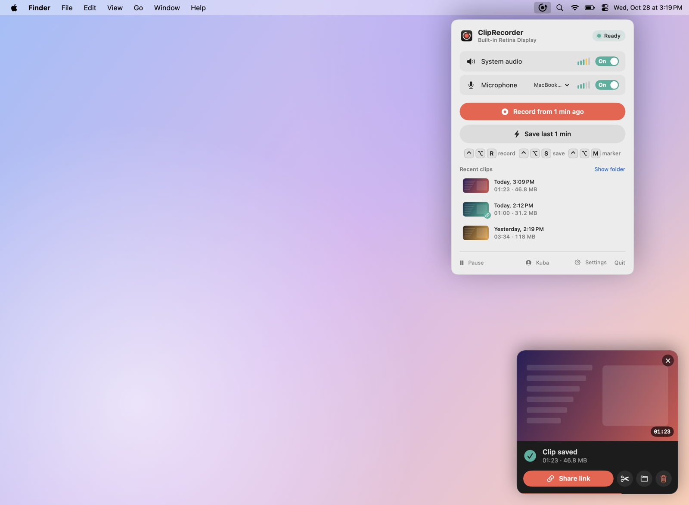
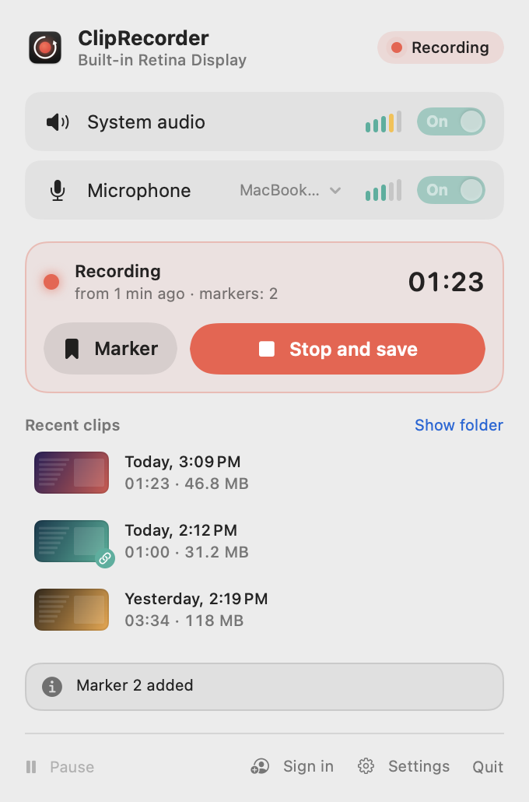
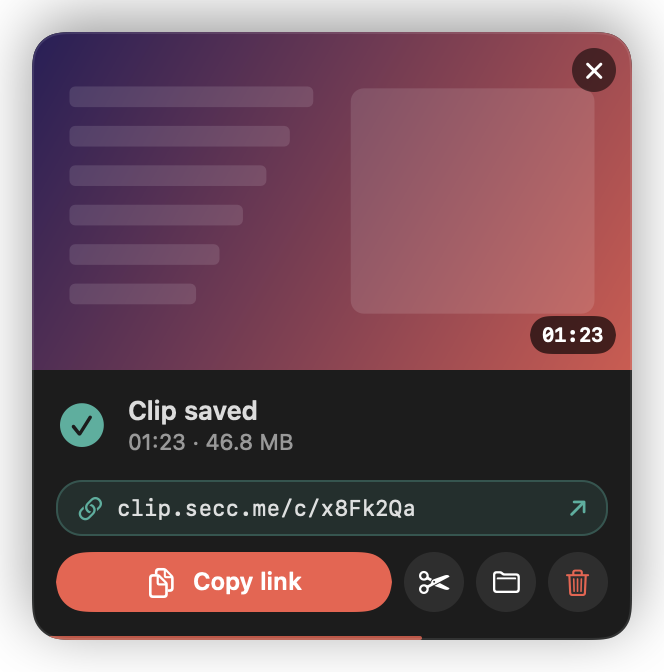
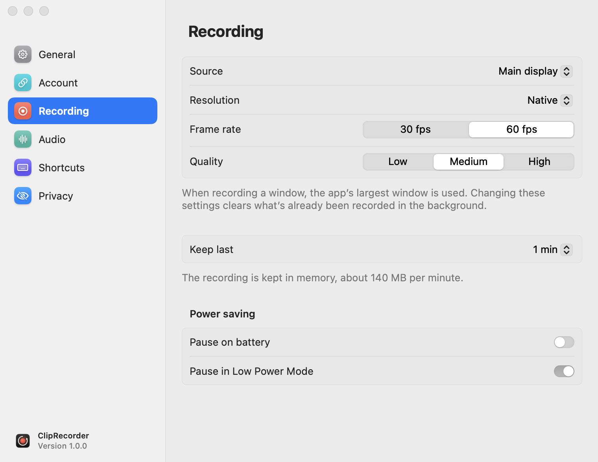

<p align="center">
  
</p>

<h1 align="center">ClipRecorder</h1>

<p align="center">
  Instant replay for your whole computer – like in games, but for everything on your screen.
</p>

<p align="center">
  <a href="README.pl.md">🇵🇱 Polski</a> ·
  <a href="https://github.com/ItsRaelx/ClipRecorder/releases/latest">Download</a> ·
  <a href="docs/en/macos/README.md">Documentation</a> ·
  <a href="docs/en/macos/troubleshooting.md">Help</a>
</p>

<picture>
  <source media="(prefers-color-scheme: dark)" srcset="docs/en/macos/screenshots/hero-dark.png">
  
</picture>

## Platforms

| | Status | |
|---|---|---|
| **macOS** 15+ | ✅ available | [download](https://github.com/ItsRaelx/ClipRecorder/releases/latest) · [docs](docs/en/macos/README.md) · code in [`macos/`](macos) |
| **Windows** 10/11 | 🚧 in progress | plan in [`windows/`](windows/README.md) |

Everything below is about the macOS app. It speaks English and Polish, following your system language.

## How it works

ClipRecorder sits in the menu bar and keeps remembering the last minute (or anything from 30 s to 10 min) of what's
on your screen, together with system audio and your microphone. Something worth keeping just happened? Press a
shortcut and the clip contains what **already happened**.

| Shortcut (default) | Action |
|---|---|
| <kbd>⌃</kbd><kbd>⌥</kbd><kbd>R</kbd> | saves the last N s **and keeps recording**; press again to finish the clip |
| <kbd>⌃</kbd><kbd>⌥</kbd><kbd>S</kbd> | instantly saves **only** the last N s |
| <kbd>⌃</kbd><kbd>⌥</kbd><kbd>M</kbd> | adds a marker while recording (a chapter in the file) |

Shortcuts work everywhere, including games and full-screen apps, and you can change them in Settings.

## Features

<table>
<tr>
<td width="50%" valign="top">

**Background recording**
- 30 s – 10 min buffer (up to 2 min in memory, longer on disk)
- hardware-encoded HEVC video, 30/60 fps, up to native resolution
- whole screen, a specific display or a single app's window
- hide chosen apps (e.g. your password manager) from recordings
- markers saved as chapters

**Audio**
- separate *System audio* and *Microphone* tracks for editing
- a default *Mix* track with volume control and a limiter
- automatic mode skips Bluetooth mics, so music in your AirPods keeps its quality

</td>
<td width="50%" valign="top">

<picture>
  <source media="(prefers-color-scheme: dark)" srcset="docs/en/macos/screenshots/popover-recording-dark.png">
  
</picture>

</td>
</tr>
<tr>
<td width="50%" valign="top">



</td>
<td width="50%" valign="top">

**After saving**
- a preview card in the corner of the screen: watch it, drag it into Discord or Finder, trim it, delete it
- QuickTime-style trimming without re-encoding
- **share by link** via [clip.secc.me](https://clip.secc.me): one click and the link is on your clipboard;
  Discord, Messenger or Slack show a player
- automatic cleanup of old clips to the Trash

**Comfort**
- pause for 15 min, an hour or until resumed; automatically on battery and in Low Power Mode
- pauses while the screen is locked
- `cliprecorder://` URLs for Shortcuts, Stream Deck and scripts
- safe saving: clips are written in fragments, and quitting finishes the clip first

</td>
</tr>
</table>

<p align="center">
  
</p>

<picture>
  <source media="(prefers-color-scheme: dark)" srcset="docs/en/macos/screenshots/settings-recording-dark.png">
  
</picture>

## Installation (macOS)

**Prebuilt release:** download the DMG from [Releases](https://github.com/ItsRaelx/ClipRecorder/releases/latest) and
drag the app into *Applications*. Test releases aren't signed with an Apple certificate yet, so the first time go to
*System Settings → Privacy & Security → Open Anyway*.

**From source** (Xcode or just the Command Line Tools):

```sh
git clone https://github.com/ItsRaelx/ClipRecorder.git
cd ClipRecorder/macos
./build.sh --install
```

On first launch, allow **Screen & System Audio Recording** and **Microphone**.
Details (signing, updates, uninstalling): [docs/en/macos/installation.md](docs/en/macos/installation.md).

Requirements: macOS 15 Sequoia or later, Apple Silicon or Intel with an HEVC encoder.

## Documentation (macOS)

| | |
|---|---|
| [Getting started](docs/en/macos/getting-started.md) | menu bar icon, popover, quick menu, how the buffer works |
| [Clips](docs/en/macos/clips.md) | saving and recording, markers, preview, trimming, files and audio tracks |
| [Sharing by link](docs/en/macos/sharing.md) | clip.secc.me account, uploading, visibility, limits |
| [Pausing and power](docs/en/macos/pausing.md) | timed pause, battery, screen lock |
| [Settings](docs/en/macos/settings.md) | every option, with screenshots |
| [Automation](docs/en/macos/automation.md) | `cliprecorder://`, Shortcuts, Stream Deck, Raycast |
| [Troubleshooting](docs/en/macos/troubleshooting.md) | permissions, Keychain, shortcuts, audio, disk space |
| [For developers](docs/en/macos/developers.md) | architecture, screenshots, releases |

## Repository layout

| Folder | Contents |
|---|---|
| [`macos/`](macos) | the macOS app (Swift package), build and release scripts, [RELEASING.md](macos/RELEASING.md) |
| [`windows/`](windows/README.md) | home of the Windows app (in progress) |
| [`docs/`](docs/README.md) | documentation for both apps, in English (`docs/en`) and Polish (`docs/pl`) |
| `.github/workflows/` | CI: `macos-build`, `macos-release` (tags `v*`); Windows will get `windows-*` (tags `windows-v*`) |

## Contributing

- Found a bug or have an idea? [Open an issue](https://github.com/ItsRaelx/ClipRecorder/issues/new/choose).
- A question? [Discussions](https://github.com/ItsRaelx/ClipRecorder/discussions).
- Want to help with code? See [CONTRIBUTING.md](CONTRIBUTING.md).
- Security issue? Report it privately as described in [SECURITY.md](SECURITY.md).

English and Polish are both welcome in issues and discussions.

## Privacy

Unless you sign in, ClipRecorder doesn't send your recordings or any data anywhere. The only network request is a
once-a-day check of GitHub's public API for a new version (you can turn it off in *Settings → General*).

Once you sign in to clip.secc.me, the app uploads **only the clips you share yourself** (with the "Share link" button
or, if you turn it on, automatically after saving). The sign-in token is kept in the Keychain, and signing out
revokes it on the server.

## License

[PolyForm Noncommercial 1.0.0](LICENSE): you may use, modify and share it, but **for noncommercial purposes only**
(personal use, hobby projects, research and education, nonprofits and public institutions). When sharing, include the
license text and the `Required Notice` line. Commercial use requires separate permission from the author.
