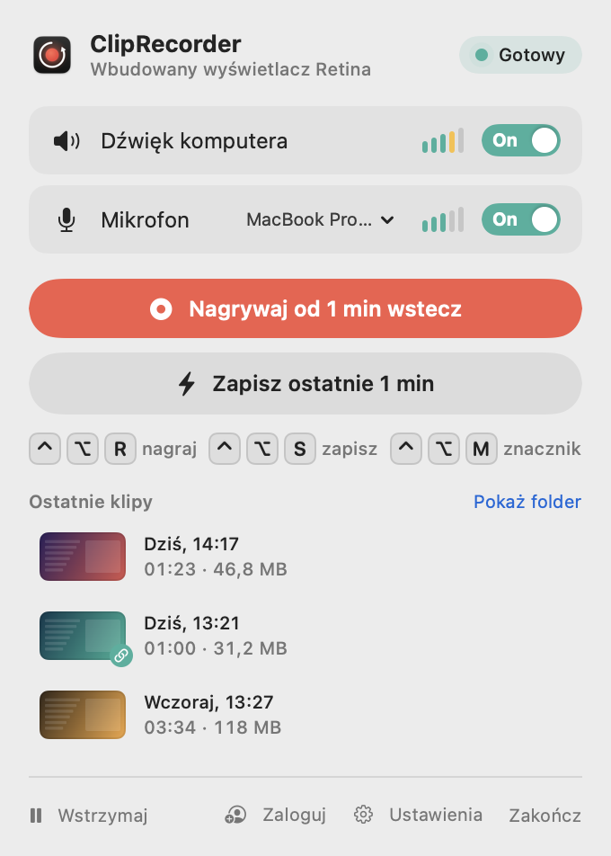
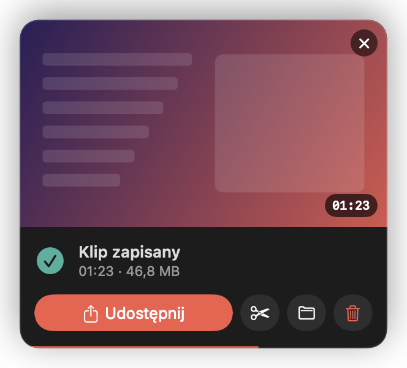
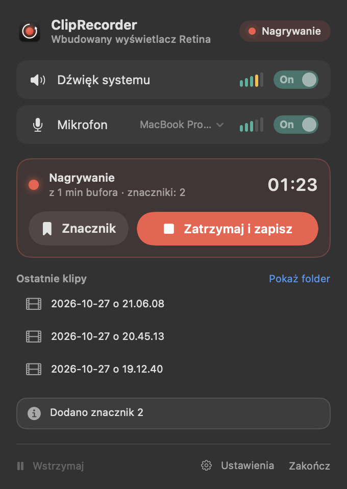
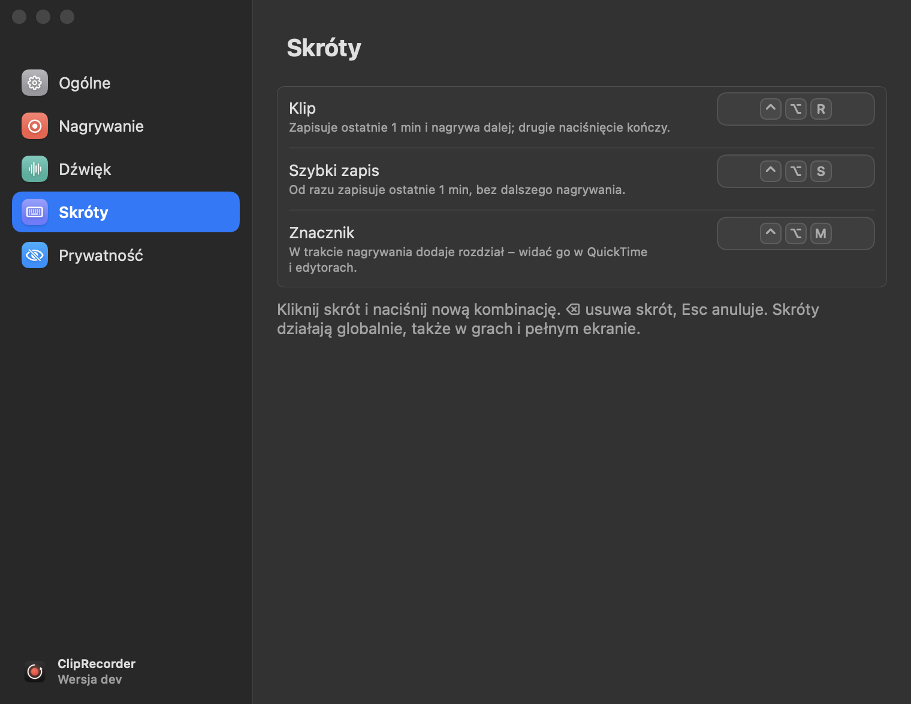

<p align="center">
  
</p>

<h1 align="center">ClipRecorder</h1>

<p align="center">
  Nagrywanie „ostatniej minuty” ekranu na macOS – jak instant replay w grach, tylko dla całego Maca.<br>
  <i>A macOS menu bar app that keeps a rolling buffer of your screen, system audio and microphone and saves the last minute with a hotkey.</i>
</p>

<p align="center">
  
  &nbsp;&nbsp;
  
</p>

## Jak to działa

ClipRecorder siedzi w pasku menu i cały czas trzyma w buforze ostatnią minutę (albo 30 s – 10 min) tego, co dzieje się na ekranie, razem z dźwiękiem z komputera i mikrofonu. Coś ciekawego się wydarzyło? Naciskasz skrót – klip zawiera to, co już minęło, i nagrywa dalej, aż naciśniesz skrót ponownie.

| Skrót (domyślnie) | Działanie |
|---|---|
| <kbd>⌃</kbd><kbd>⌥</kbd><kbd>R</kbd> | zapisuje ostatnie N s **i nagrywa dalej**; ponowne naciśnięcie kończy klip |
| <kbd>⌃</kbd><kbd>⌥</kbd><kbd>S</kbd> | od razu zapisuje **tylko** ostatnie N s |
| <kbd>⌃</kbd><kbd>⌥</kbd><kbd>M</kbd> | w trakcie nagrywania dodaje znacznik (rozdział) |

Skróty działają globalnie (także w grach i na pełnym ekranie) i można je zmienić w ustawieniach.

<p align="center">
  <br>
  
</p>

## Funkcje

- **Bufor w tle** – 30 s, 1 min, 2 min (w RAM) albo 5 / 10 min (na dysku, w `~/Library/Caches/ClipRecorder`)
- **Osobne ścieżki audio** – *Dźwięk systemu* i *Mikrofon* do montażu + domyślna ścieżka *Miks* (z regulacją głośności i ogranicznikiem), więc klip gra poprawnie wszędzie
- **Wideo HEVC** kodowane sprzętowo, 30/60 fps, rozdzielczość natywna / 1440p / 1080p / 720p, 3 poziomy jakości
- **Źródło**: dowolny monitor albo okno wybranej aplikacji; wybrane aplikacje można ukryć w nagraniu
- **Znaczniki** zapisywane jako rozdziały (widoczne w QuickTime i edytorach)
- **Podgląd po zapisie** w rogu ekranu – przeciągnij klip do Discorda/Findera, przytnij, udostępnij, usuń
- **Przycinanie** w stylu QuickTime, bez ponownego kodowania
- **Eksport MP4** (H.264, tylko ścieżka miksu) z limitem rozmiaru: Discord 10 MB / 50 MB / pełna jakość – od razu w schowku
- **Mikrofon bez psucia muzyki** – tryb automatyczny omija mikrofony Bluetooth (AirPods przy nagrywaniu z ich mikrofonu przełączają się w słabszy tryb rozmowy)
- **Oszczędzanie energii** – wstrzymywanie bufora ręcznie, na baterii lub w trybie niskiego zużycia energii
- **Porządek** – automatyczne przenoszenie starych klipów do Kosza (po czasie lub po przekroczeniu rozmiaru folderu)

<p align="center">
  
  &nbsp;&nbsp;
  
</p>

## Wymagania

- macOS 15 Sequoia lub nowszy (Apple Silicon lub Intel z enkoderem HEVC) – wydania są uniwersalne
- Xcode albo same Command Line Tools (`xcode-select --install`) – Swift 6

## Instalacja

### Ze źródeł (zalecane na razie)

```sh
git clone https://github.com/ItsRaelx/ClipRecorder.git
cd ClipRecorder
./build.sh --install   # buduje, kopiuje do /Applications i uruchamia
```

Samo `./build.sh` tworzy `build/ClipRecorder.app` bez instalowania.

### Gotowe wydania

Wersje testowe (DMG) pojawiają się w [Releases](https://github.com/ItsRaelx/ClipRecorder/releases).
Nie są jeszcze podpisane certyfikatem Apple, więc przy pierwszym uruchomieniu wejdź w
Ustawienia systemowe → Prywatność i ochrona → **Otwórz mimo to**.

### Uprawnienia

Przy pierwszym uruchomieniu zezwól na **Mikrofon** oraz **Nagrywanie ekranu i dźwięku systemowego**
(Ustawienia systemowe → Prywatność i ochrona), a potem uruchom aplikację ponownie.

### Podpisywanie przy budowaniu ze źródeł

macOS wiąże uprawnienia do nagrywania ekranu z podpisem aplikacji. Żeby nie trzeba było ich nadawać po każdym przebudowaniu,
`build.sh` przy pierwszym uruchomieniu **tworzy lokalny, samopodpisany certyfikat „ClipRecorder Local Signing”
w pęku kluczy *login*** i podpisuje nim aplikację. Certyfikat służy tylko do podpisywania tej aplikacji na Twoim Macu;
możesz go w każdej chwili usunąć w aplikacji *Dostęp do pęku kluczy*.

Inne opcje:

```sh
SIGN_IDENTITY="Apple Development: Jan Kowalski (ABCDE12345)" ./build.sh --install  # własny certyfikat
SIGN_IDENTITY=- ./build.sh                                                          # ad-hoc (uprawnienia resetują się po każdym buildzie)
```

Jeśli po przebudowaniu macOS pyta o uprawnienia, mimo że są włączone w Ustawieniach, zresetuj stare wpisy:

```sh
tccutil reset ScreenCapture io.github.itsraelx.ClipRecorder
tccutil reset Microphone io.github.itsraelx.ClipRecorder
```

## Ścieżki audio w klipie

1. **Miks (system + mikrofon)** – domyślna, grają ją wszystkie odtwarzacze
2. **Dźwięk systemu** – osobno, do montażu
3. **Mikrofon** – osobno, do montażu

Wszystkie trzy są w jednej grupie alternatywnej, więc odtwarzacz gra tylko miks (bez dublowania), a w VLC/IINA
można przełączyć się na pojedynczą ścieżkę. DaVinci Resolve, Final Cut czy Premiere widzą wszystkie ścieżki osobno.

## Jak to jest zbudowane

| Plik | Rola |
|---|---|
| `CaptureEngine.swift` | ScreenCaptureKit (ekran, dźwięk systemu, mikrofon), kodowanie HEVC przez VideoToolbox, bufor i klipy |
| `SampleRing.swift` | bufor próbek – w RAM albo w 10-sekundowych plikach na dysku |
| `ClipWriter.swift` | zapis klipu (AVAssetWriter, passthrough wideo + AAC) |
| `ClipFinalizer.swift` | po zapisie: ścieżka miksu z ogranicznikiem, rozdziały, przycinanie – bez ponownego kodowania obrazu |
| `ShareExporter.swift` | eksport MP4 H.264 z limitem rozmiaru |
| `HotKey.swift` | globalne skróty (Carbon `RegisterEventHotKey` – bez uprawnień Dostępności) |
| `AppState.swift` | stan i ustawienia aplikacji |
| `PopoverView.swift`, `RecordingHUD.swift`, `ClipPreview.swift`, `SettingsView.swift` | interfejs (SwiftUI) |
| `UpdateChecker.swift` | sprawdzanie nowych wersji w GitHub Releases |
| `build.sh` / `release.sh` | build deweloperski / universal DMG z opcjonalnym podpisem i notaryzacją |
| `Tools/make-icon.swift` | generator ikony aplikacji |

Podgląd interfejsu bez uruchamiania nagrywania (renderuje PNG do wskazanego folderu):

```sh
swift build -c release && .build/release/ClipRecorder --snapshot /tmp/clipsnap
```

## Prywatność

ClipRecorder nie wysyła nigdzie nagrań ani danych. Jedyne połączenie sieciowe to raz dziennie zapytanie do
publicznego API GitHuba o najnowszą wersję (można je wyłączyć w Ustawieniach → Ogólne).

## Wydawanie

Jak zbudować DMG i (z kontem Apple Developer) podpisane, notaryzowane wydania: [RELEASING.md](RELEASING.md).

## Ograniczenia

- Nagrywany jest jeden ekran lub jedno okno naraz.
- Zmiana źródła, rozdzielczości, FPS lub jakości czyści bufor.
- Bufor 5 / 10 min oznacza ciągły zapis na dysk (rzędu 100–300 MB na minutę, nadpisywany w kółko).

## Licencja

[PolyForm Noncommercial 1.0.0](LICENSE) – wolno używać, modyfikować i udostępniać dalej, ale **tylko w celach niekomercyjnych** (osobiście, hobbystycznie, w nauce, w organizacjach non-profit i instytucjach publicznych). Przy udostępnianiu trzeba dołączyć tekst licencji i linijkę `Required Notice`. Użycie komercyjne wymaga osobnej zgody autora.
