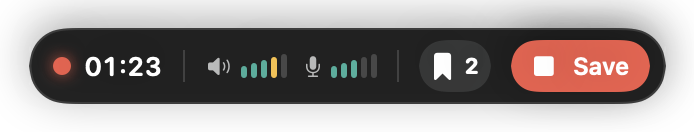
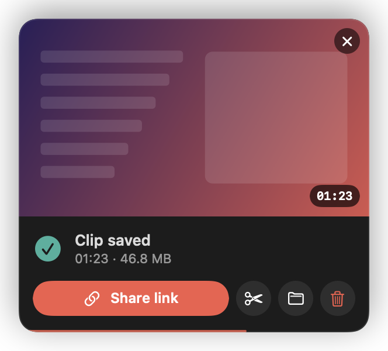
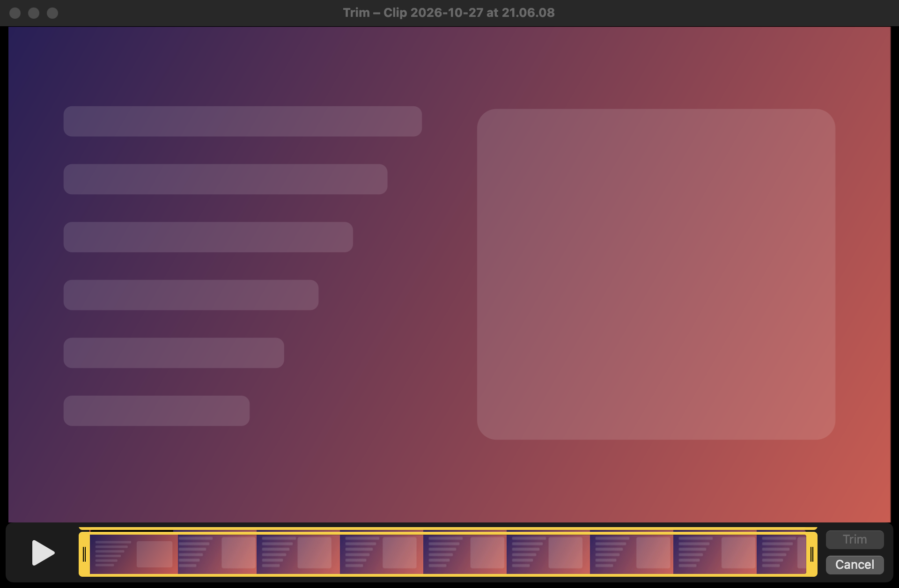

# Clips

[← Contents](README.md) · [🇵🇱 Polski](../../pl/macos/klipy.md)

## Two ways to save

| | Save last N | Record from N ago |
|---|---|---|
| Shortcut | <kbd>⌃</kbd><kbd>⌥</kbd><kbd>S</kbd> | <kbd>⌃</kbd><kbd>⌥</kbd><kbd>R</kbd> (press again to finish) |
| What goes into the clip | just the buffer, that is, what has already happened | the buffer + everything until you stop |
| When | “that was good, save it” | “something cool is about to happen, keep recording” |

You set the buffer length (N) in [Settings → Recording](settings.md#recording): 30 s, 1, 2, 5 or 10 min.

The shortcuts work in every app, including games and full-screen apps. The same actions are available in the popover,
in the [quick menu](getting-started.md#quick-menu-right-click-the-icon) and through
[automation URLs](automation.md).

## Recording bar

While recording, a small bar slides down at the top of the screen:

- the clip time;
- live system audio and microphone levels;
- a bookmark button: adds a marker and shows how many there are so far;
- **Save**: finishes the clip.

The bar, the popover, the preview card and other ClipRecorder windows **never show up in recordings**.

## Markers

<kbd>⌃</kbd><kbd>⌥</kbd><kbd>M</kbd> (or the **Marker** button) marks an important moment while recording.
Every clip gets chapters:

| Chapter | Where |
|---|---|
| *Buffer* | the start of the clip |
| *Recording started* | the moment you pressed the shortcut (only with *Record from N ago*) |
| *Marker 1*, *Marker 2*, … | your markers |

Chapters show up in QuickTime Player (*View → Show Chapters*), IINA, VLC and video editors, so it's easy
to jump to the interesting part.

## Preview after saving

After a clip is saved, a card slides in at the bottom-right corner of the screen:

- **Click the thumbnail** to watch the clip in your default player.
- **Drag the thumbnail** into Discord, Messenger, Slack, Finder or a video editor. They get a ready-to-use file.
- **Share link** uploads the clip to clip.secc.me and copies the link ([more](sharing.md)).
- ✂︎ trims the clip, and 📁 shows it in Finder.
- The trash button moves the clip to the system Trash.
- The card disappears by itself after 8 seconds (the bar at the bottom counts down). Hovering over it pauses the countdown.
- **✕** closes it right away.

You can turn the card off in *Settings → General → Show preview after saving*.

## Recent clips

The popover shows the three newest clips. **Show folder** opens the whole folder in Finder.

| Icon on the thumbnail | Meaning |
|---|---|
| green chain | the clip already has a link on clip.secc.me |
| progress bar | the clip is being uploaded |

Hover over a row to see quick actions: link, trim and the **⋯** menu.
**Double-click** opens the clip, and you can also **drag** the row like a file. Right-click and **⋯** show the full menu:

- Share link / Copy link / Open link (or *Cancel upload*);
- Open, Show in Finder, Copy file;
- Trim…;
- Move to Trash.

## Trimming

Trimming works just like in QuickTime Player:

1. Drag the yellow handles to the start and end of the part you want.
2. Click **Trim**.

The clip is trimmed **without re-encoding the video**, so it takes a moment and loses no quality.
The file is overwritten, and the chapters and audio tracks stay in place.

> If the clip was already shared by link, the app “forgets” that link, because the server has the version from
> before the trim. Share it again so the link shows the trimmed version.

## Files

- Folder: `~/Movies/Clips`. You can change it in [Settings → General](settings.md#general).
- Name: `Clip 2026-10-27 at 21.06.08.mov`. If two clips are created in the same second, the second one gets ` (2)`.
- Format: QuickTime `.mov`, hardware-encoded **HEVC (H.265)** video, 48 kHz AAC audio.
- A clip is written as it goes, in 5-second fragments. If the app or the system crashes mid-recording,
  everything up to the last fragment can be played back.
- Quitting the app while recording finishes and saves the clip first.

### Audio tracks

Every clip has up to three audio tracks:

1. **Mix (system + microphone)** – the default track that every player plays;
2. **System audio** – separately, for editing;
3. **Microphone** – separately, for editing.

All three are in one alternate group. So a regular player plays only the mix, without doubled sound,
and in VLC or IINA you can switch to a single track. DaVinci Resolve, Final Cut Pro and Premiere Pro
see all the tracks separately. You set the volume of both sources in the mix in [Settings → Audio](settings.md#audio).

### Disk space

Before saving, the app checks free space:

- below **3 GB** it warns you;
- below **300 MB** it refuses to save, so the disk doesn't fill up completely.

It can also move old clips to the Trash automatically, based on age or folder size
([Settings → General](settings.md#general)).
