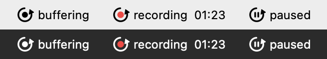
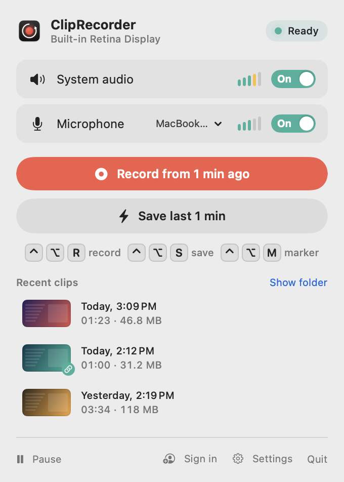

# Getting started

[← Contents](README.md) · [🇵🇱 Polski](../../pl/macos/pierwsze-kroki.md)

## How the buffer works

From the moment it launches, ClipRecorder records the screen, system audio and microphone in the background, but
**doesn't save anything**. It only keeps the last N seconds (1 minute by default) and keeps overwriting older ones.
A file is created only when you press a shortcut or a button:

- **Save last N** (<kbd>⌃</kbd><kbd>⌥</kbd><kbd>S</kbd>) saves just the buffer, that is, what has already happened.
- **Record from N ago** (<kbd>⌃</kbd><kbd>⌥</kbd><kbd>R</kbd>) starts the clip with the buffer and keeps recording
  until you press the shortcut again.

A buffer of up to 2 minutes is kept in memory, while 5 and 10 minutes are kept on disk (`~/Library/Caches/ClipRecorder`).
See [Settings → Recording](settings.md#recording) for details.

## Menu bar icon

| Icon | Meaning |
|---|---|
| circle with an arrow | the buffer is running, ready to save |
| red dot and a timer | a clip is being recorded |
| circle with a pause sign | background recording is paused ([more](pausing.md)) |
| exclamation mark | no screen recording permission |

Hover over it to see the current state in a tooltip, e.g. *ClipRecorder – ready, keeping the last 1 min*.

- **Left-click** opens the popover.
- **Right-click** (or <kbd>⌃</kbd>-click) opens the quick menu.

## Popover

<picture>
  <source media="(prefers-color-scheme: dark)" srcset="screenshots/popover-idle-dark.png">
  
</picture>

From the top:

1. **Header:** what's being recorded (the screen or an app window) and the state: *Ready*, *Recording*, *Paused*,
   *No access* or *Starting…*.
2. **Audio sources:**
   - turn **System audio** and **Microphone** on and off with the *On/Off* buttons;
   - the meters next to them show live levels;
   - the microphone has a menu for picking the device.

   If the selected microphone is a Bluetooth headset, a warning appears. Such headsets then switch to call mode
   and music sounds worse.
3. **Main buttons:** *Record from N ago* and *Save last N*, with a shortcut reminder below them.
4. **Recent clips:** the three newest clips with a thumbnail, date, length and size ([more](clips.md#recent-clips)).
5. **Messages:** short confirmations, e.g. *Marker 2 added* or *Link copied.*
6. **Footer:**
   - **Pause** (a menu with pause durations);
   - account: **Sign in** or your name;
   - **Settings**;
   - **Quit**.

While recording, the main buttons are replaced by a recording card with the time, the number of markers
and the **Marker** and **Stop and save** buttons:

<picture>
  <source media="(prefers-color-scheme: dark)" srcset="screenshots/popover-recording-dark.png">
  
</picture>

Audio sources can't be changed during a clip, so they're grayed out.

## Quick menu (right-click the icon)

The most common actions without opening the popover:

| Item | When |
|---|---|
| Record from N ago / Save last N | when the buffer is ready |
| Stop and save / Add marker | while recording |
| Open last clip | when there's at least one clip |
| Show clips folder | always |
| Pause ▸ For 15 minutes / For 1 hour / Until resumed | when you're not recording a clip |
| Resume background recording | when you paused manually |
| Settings… / Quit ClipRecorder | always |

## Your first clip in 30 seconds

1. Launch the app and grant the permissions ([Installation → Permissions](installation.md#permissions)).
2. Work as usual. The buffer fills up in the background.
3. Press <kbd>⌃</kbd><kbd>⌥</kbd><kbd>S</kbd>. A **Clip saved** card appears in the bottom-right corner.
4. Click the thumbnail to watch the clip, or drag it straight into Discord, Messenger or Finder.
