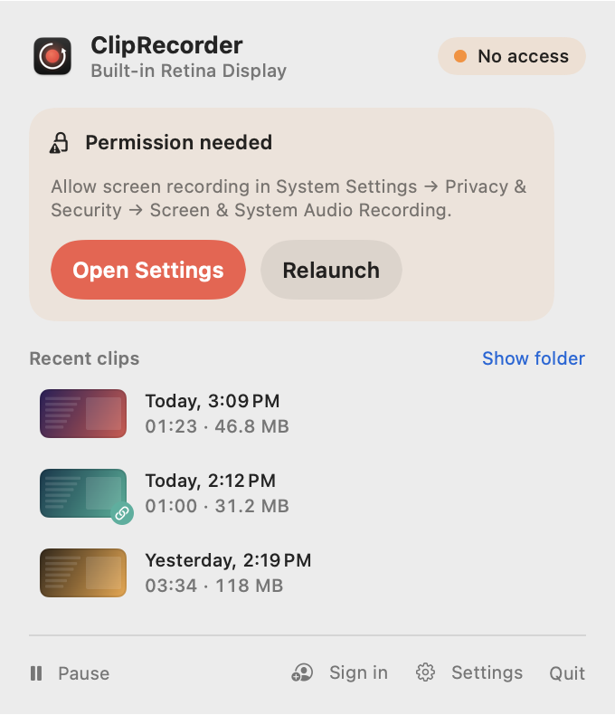
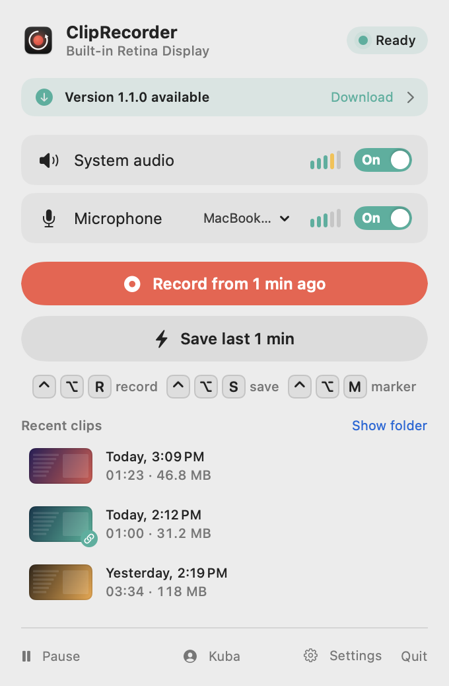

# Installation

[← Contents](README.md) · [🇵🇱 Polski](../../pl/macos/instalacja.md)

## Requirements

- macOS 15 Sequoia or later.
- A Mac with Apple Silicon, or an Intel Mac with a hardware HEVC encoder (practically any Mac from recent years).
  Releases are universal.
- To build from source: Xcode or just the Command Line Tools (`xcode-select --install`).

## Prebuilt release (DMG)

1. Download the latest `.dmg` file from [Releases](https://github.com/ItsRaelx/ClipRecorder/releases).
2. Open it and drag **ClipRecorder** to the **Applications** folder.
3. Launch the app. Test releases aren't signed with an Apple certificate, so macOS blocks them the first time.
   Go to *System Settings → Privacy & Security* and click **Open Anyway**.

Every downloaded release comes with a `.sha256` checksum file next to it:

```sh
shasum -a 256 -c ClipRecorder-1.0.0.dmg.sha256
```

## From source

```sh
git clone https://github.com/ItsRaelx/ClipRecorder.git
cd ClipRecorder/macos
./build.sh --install   # builds, copies to /Applications and launches
```

Plain `./build.sh` creates `macos/build/ClipRecorder.app` without installing it. Run all the commands below
in the `macos/` folder.

### Build signing

macOS ties screen recording permissions to the app's signature. So that you don't have to grant them again after
every rebuild, `build.sh` creates a local, self-signed certificate **“ClipRecorder Local Signing”** in your *login*
keychain on its first run and signs the app with it. The certificate is used for nothing else. You can delete it
at any time in the *Keychain Access* app.

```sh
SIGN_IDENTITY="Apple Development: John Appleseed (ABCDE12345)" ./build.sh --install  # your own certificate
SIGN_IDENTITY=- ./build.sh                                                            # ad-hoc: permissions are lost after every build
```

## Permissions

On first launch, macOS asks for two permissions:

| Permission | What for |
|---|---|
| **Screen & System Audio Recording** | the picture and system audio. Without it the app can't record anything |
| **Microphone** | your voice. Without it clips are recorded without the microphone |

Until the app has screen access, the popover shows a **Permission needed** card:

<picture>
  <source media="(prefers-color-scheme: dark)" srcset="screenshots/popover-permission-dark.png">
  
</picture>

- **Open Settings** takes you straight to the right place in System Settings.
- Once you turn access on, the card changes to **Permission granted** by itself. macOS requires the app to be
  relaunched, so just click **Relaunch**.

Keyboard shortcuts do **not** need Accessibility or Input Monitoring permissions.

## Launch at login

*Settings → General → Launch at login.* The app also shows up in
*System Settings → General → Login Items*.

## Updates

Once a day, the app asks GitHub's public API for the latest release. If it's newer, a banner appears in the popover:

<picture>
  <source media="(prefers-color-scheme: dark)" srcset="screenshots/popover-update-dark.png">
  
</picture>

**Download** opens the release page. You can turn the check off in *Settings → General → Check for updates*.

## Uninstalling

1. Quit the app (popover → **Quit**).
2. Delete `/Applications/ClipRecorder.app`.
3. Optionally, clean up:

```sh
rm -rf ~/Library/Caches/ClipRecorder                          # on-disk buffer (5 / 10 min)
defaults delete io.github.itsraelx.ClipRecorder               # settings
tccutil reset ScreenCapture io.github.itsraelx.ClipRecorder   # permissions
tccutil reset Microphone io.github.itsraelx.ClipRecorder
```

Your clips in `~/Movies/Clips` stay where they are. If you were signed in, sign out before deleting the app.
Signing out revokes the token on the server and removes it from the keychain.
