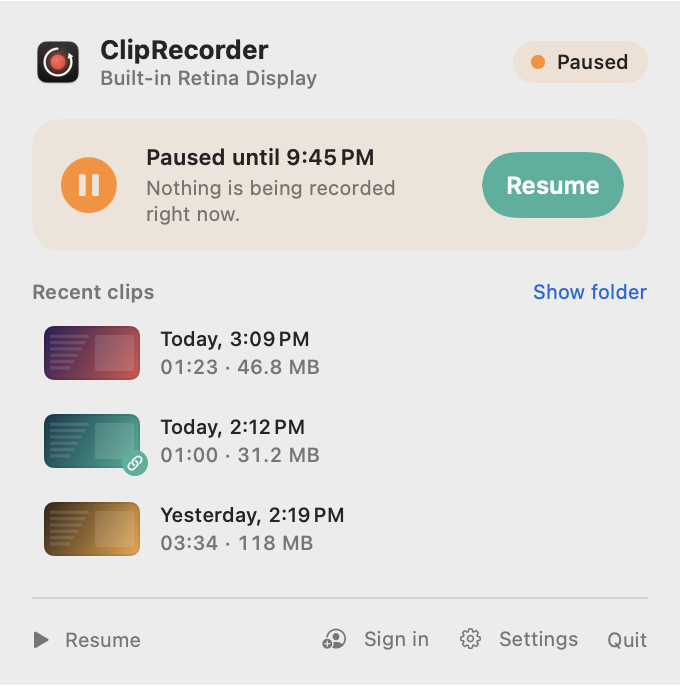
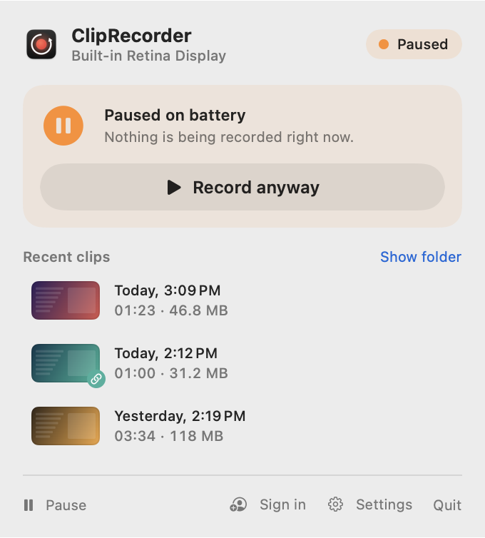

# Pausing and power saving

[← Contents](README.md) · [🇵🇱 Polski](../../pl/macos/wstrzymywanie.md)

The background buffer means continuous video encoding. On Apple Silicon this usually takes a few percent of CPU, but
on battery or during a presentation you may want the app to stop recording for a while.

## Manual pause

Click **Pause** in the popover footer (or in the [quick menu](getting-started.md#quick-menu-right-click-the-icon))
and choose how long:

- **For 15 minutes**
- **For 1 hour**
- **Until resumed**

<picture>
  <source media="(prefers-color-scheme: dark)" srcset="screenshots/popover-paused-timed-dark.png">
  
</picture>

The popover shows when the pause ends. After that, background recording resumes by itself. The pause survives
an app relaunch. **Resume** (on the card or in the footer) resumes right away.

You can't pause while recording a clip, so finish it first. While paused, the buffer is empty
and the save shortcuts have nothing to save.

## Automatic: battery and Low Power Mode

In [Settings → Recording](settings.md#recording):

| Option | Default | What it does |
|---|---|---|
| Pause on battery | off | pauses when your MacBook isn't plugged in |
| Pause in Low Power Mode | **on** | pauses when Low Power Mode is on |

<picture>
  <source media="(prefers-color-scheme: dark)" srcset="screenshots/popover-paused-power-dark.png">
  
</picture>

- **Record anyway** resumes recording until the next power change, e.g. until you plug in or unplug the charger.
- A clip in progress **always records to the end**. Unplugging the charger mid-recording won't interrupt it.
  The pause starts only after the clip is saved.

## Screen lock and sleep

When you lock your Mac or the display goes to sleep, there's nothing to record. The app switches to
*Screen locked* by itself and goes back to recording right after you unlock. There's nothing you need to do.
