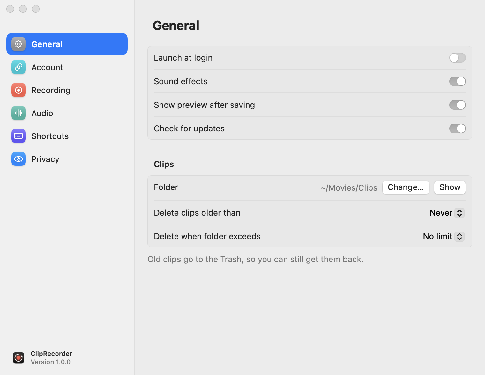
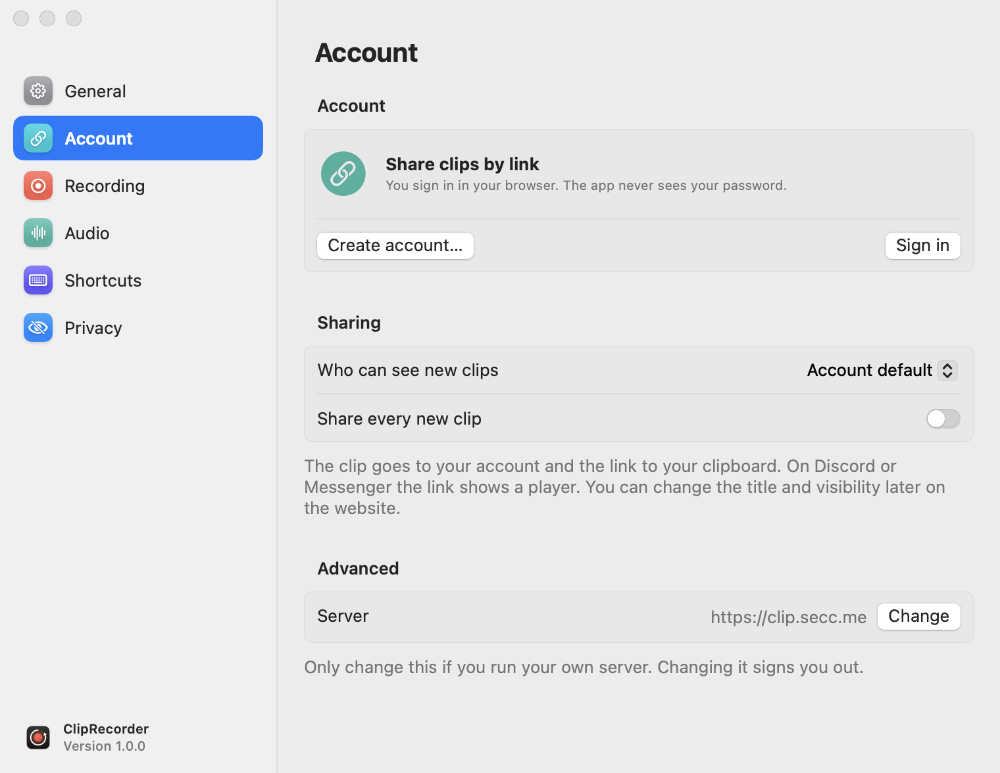
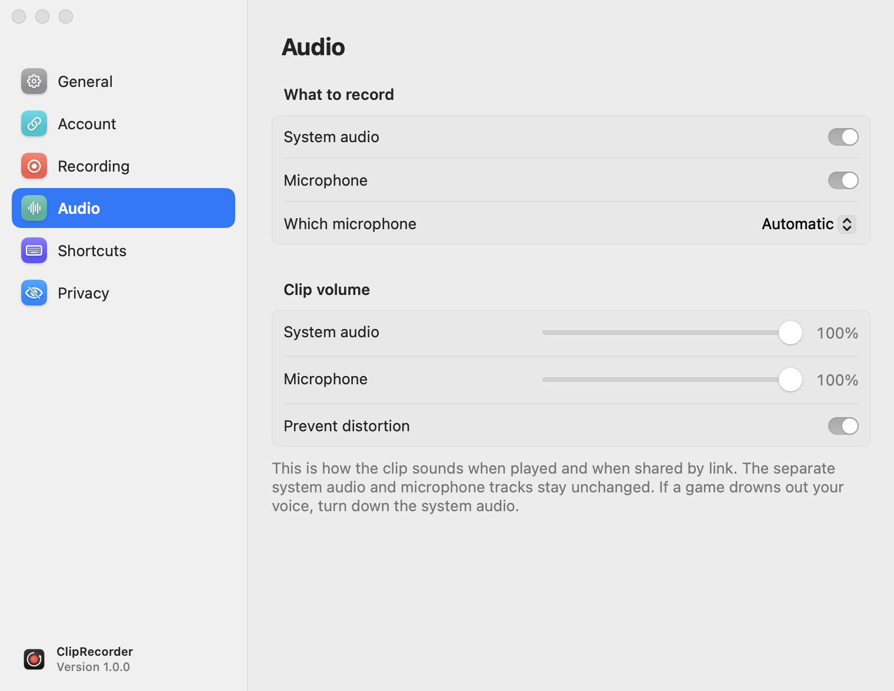
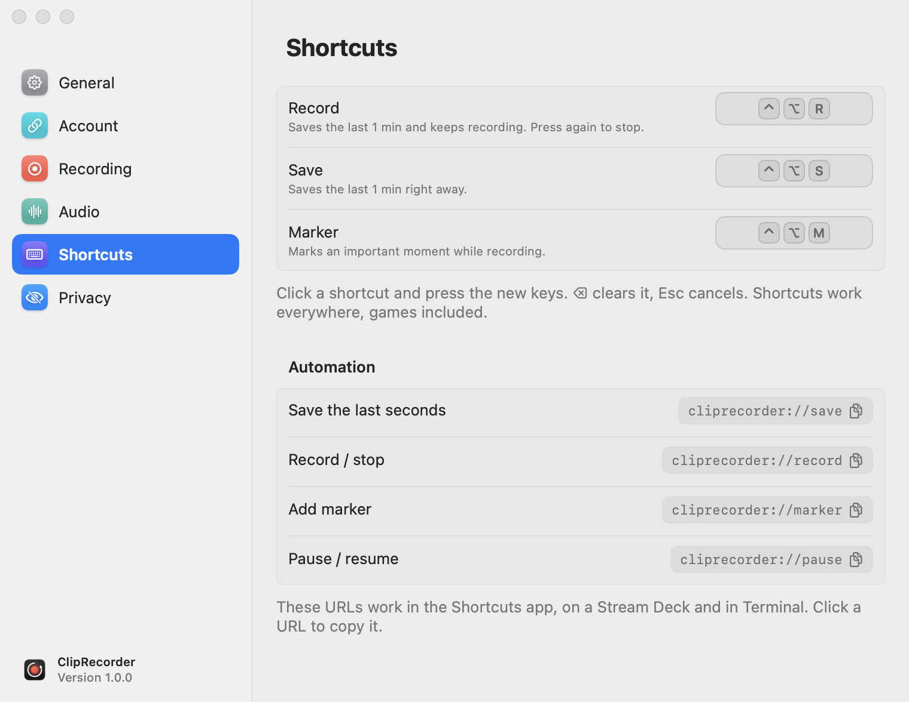
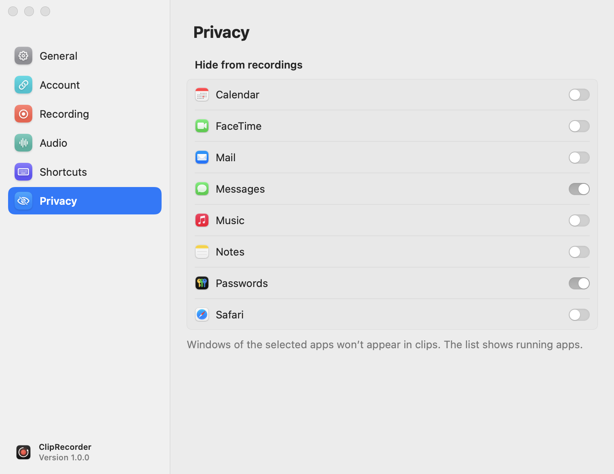

# Settings

[← Contents](README.md) · [🇵🇱 Polski](../../pl/macos/ustawienia.md)

You can open the Settings window:
- with the **Settings** button in the popover;
- from the quick menu (right-click the icon);
- with the `cliprecorder://settings` URL.

The window has six sections. Changes take effect immediately, there's no “Save” button.

## General

<picture>
  <source media="(prefers-color-scheme: dark)" srcset="screenshots/settings-general-dark.png">
  
</picture>

| Option | Description |
|---|---|
| Launch at login | the app starts together with the system |
| Sound effects | short sounds when recording starts, on a marker, on save, on share and on errors |
| Show preview after saving | the “Clip saved” card in the corner of the screen ([more](clips.md#preview-after-saving)) |
| Check for updates | asks GitHub for a new version once a day |
| Folder | where clips go (`~/Movies/Clips` by default). **Change…** picks another one, **Show** opens it in Finder |
| Delete clips older than | Never / 7 / 30 / 90 days |
| Delete when folder exceeds | No limit / 10 / 20 / 50 / 100 GB. The oldest clips go first |

Cleanup moves clips to the **Trash**, so you can get them back. It only affects files recorded by ClipRecorder
(`Clip …`) and leaves other files in the folder alone.

## Account

<picture>
  <source media="(prefers-color-scheme: dark)" srcset="screenshots/settings-account-signed-out-dark.png">
  
</picture>

| Option | Description |
|---|---|
| Create account… / Sign in | signing in in the browser with a code ([more](sharing.md#signing-in)) |
| My clips / Sign out | when signed in: the dashboard on the website and signing out |
| Plan, storage used, uploads today | account limits ([more](sharing.md#account-and-limits)) |
| Who can see new clips | Account default / Public / Unlisted / Private |
| Share every new clip | automatic upload after every save |
| Server | the server address, only for your own installation. Changing it signs you out |

## Recording

<picture>
  <source media="(prefers-color-scheme: dark)" srcset="screenshots/settings-recording-dark.png">
  
</picture>

| Option | Values | Description |
|---|---|---|
| Source | Main display, a specific monitor, Window: *app* | with an app window, its largest window is recorded |
| Resolution | Native / 1440p / 1080p / 720p | “Native” is the display's native resolution. Lower means smaller files and less work for the encoder |
| Frame rate | 30 / 60 fps | 60 fps for games and fast motion |
| Quality | Low / Medium / High | HEVC bitrate. Medium is enough for most uses |
| Keep last | 30 s / 1 / 2 / 5 / 10 min | the buffer length |
| Pause on battery | | [more](pausing.md#automatic-battery-and-low-power-mode) |
| Pause in Low Power Mode | | same as above |

Below the buffer option, the app shows how much one minute of recording takes with the current settings.

- A buffer of up to 2 minutes is kept **in memory**.
- 5 and 10 minutes mean continuous writing **to disk** (`~/Library/Caches/ClipRecorder`), overwritten in a loop.
- Changing the source, resolution, frame rate or quality **clears the current buffer**, because the encoder starts over.

## Audio

<picture>
  <source media="(prefers-color-scheme: dark)" srcset="screenshots/settings-audio-dark.png">
  
</picture>

| Option | Description |
|---|---|
| System audio | everything that plays on your Mac: games, videos, calls |
| Microphone | your voice |
| Which microphone | **Automatic** or a specific device |
| Clip volume: System audio / Microphone | the balance in the *Mix* track (0–100%) |
| Prevent distortion | a limiter that turns down sudden loud sounds in the mix |

**Automatic** uses the system's default microphone, but skips Bluetooth microphones when another one (built-in or
wired) is available. Recording from the microphone of AirPods and other Bluetooth headsets switches them to call mode,
which makes music and games sound much worse.

The volume only affects the *Mix* track. The separate *System audio* and *Microphone* tracks stay untouched
([more about tracks](clips.md#audio-tracks)).

## Shortcuts

<picture>
  <source media="(prefers-color-scheme: dark)" srcset="screenshots/settings-shortcuts-dark.png">
  
</picture>

Click a shortcut field and press the new keys. <kbd>⌫</kbd> removes the shortcut, and <kbd>Esc</kbd> cancels the change.
While you're setting one, the other shortcuts are turned off so you don't start a recording by accident.

Rules:
- a shortcut must include <kbd>⌃</kbd> or <kbd>⌘</kbd>, or <kbd>⌥</kbd><kbd>⇧</kbd> together, so it doesn't get in
  the way of typing (e.g. <kbd>⌥</kbd><kbd>A</kbd> types “å”, or “ą” on a Polish keyboard);
- function keys (<kbd>F1</kbd>–<kbd>F20</kbd>) can be used on their own;
- a shortcut can have only one action. Assigning it to another action removes it from the previous one;
- if another app already uses the shortcut, you'll see **Used by another app**.

The **Automation** section below lists URLs for the Shortcuts app, Stream Deck and scripts.
Clicking a URL copies it ([more](automation.md)).

## Privacy

<picture>
  <source media="(prefers-color-scheme: dark)" srcset="screenshots/settings-privacy-dark.png">
  
</picture>

**Hide from recordings:** windows of the selected apps won't show up in clips. The clip shows whatever is underneath them.
Handy for a password manager, messaging apps or email. The list shows running apps plus the ones you've
already hidden. An app you've hidden that you launch later will be hidden too.

ClipRecorder's own windows (the popover, the recording bar, the preview card, Settings) are always hidden.
