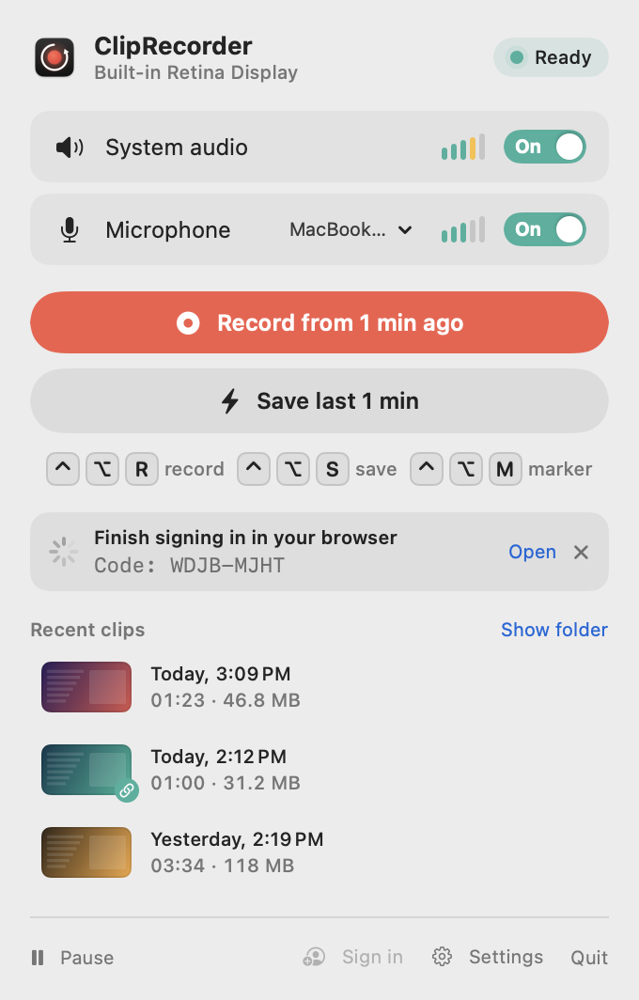
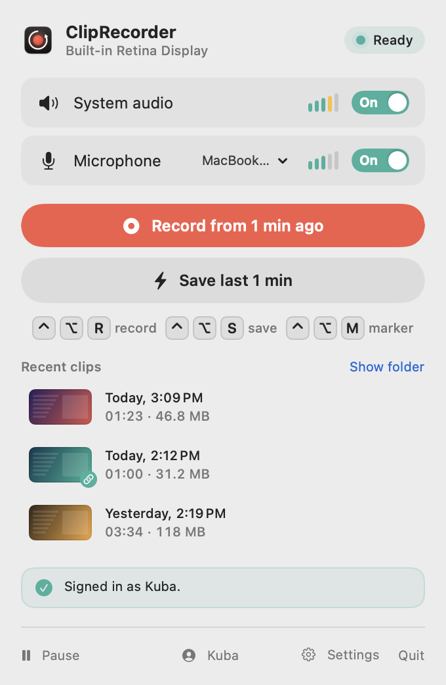
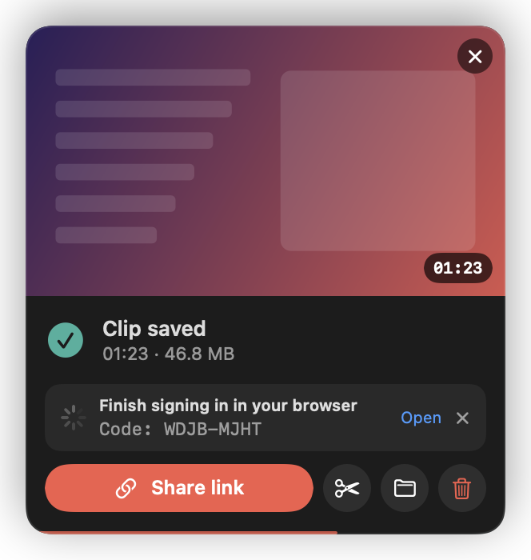
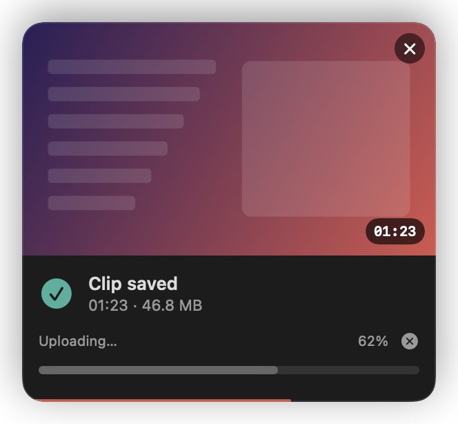
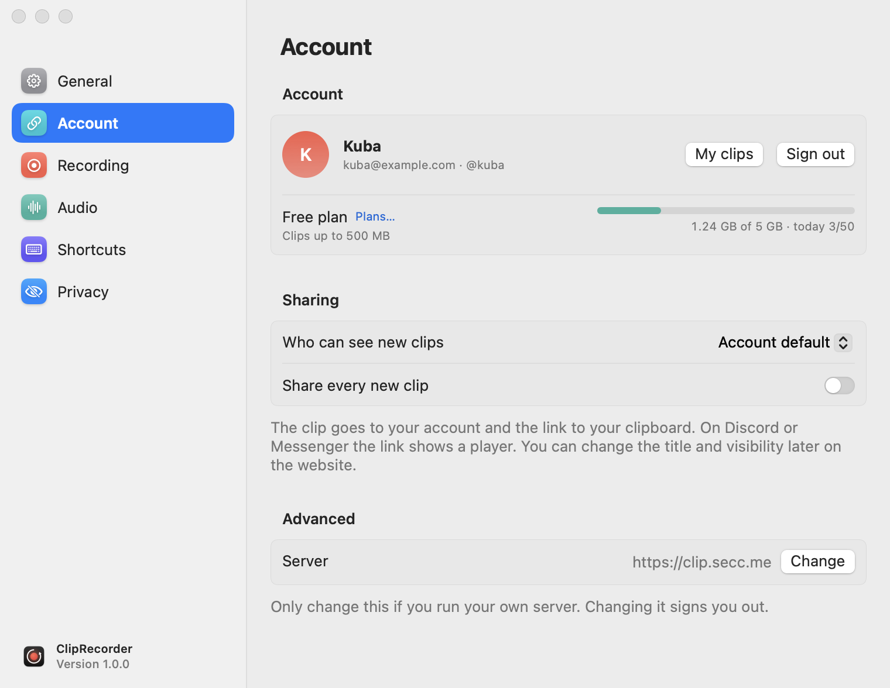

# Sharing by link (clip.secc.me)

[← Contents](README.md) · [🇵🇱 Polski](../../pl/macos/udostepnianie.md)

Instead of sending a file, you can send a link. The clip goes to your account on [clip.secc.me](https://clip.secc.me),
and the link lands on your clipboard. Discord, Messenger, Slack or iMessage show a player under the link.

Sharing is **completely optional**. Without signing in, ClipRecorder never uploads anything anywhere.

## Signing in

You sign in in your browser. The app never sees your password.

1. Click **Sign in** in the popover footer or *Settings → Account → Sign in*.
   If you don't have an account, choose **Create account…**.
2. Your browser opens with a code, and the popover shows the same code:

<picture>
  <source media="(prefers-color-scheme: dark)" srcset="screenshots/popover-login-dark.png">
  
</picture>

3. Check that the codes match and click **Allow and connect** on the website. A moment later the popover shows your name.

<picture>
  <source media="(prefers-color-scheme: dark)" srcset="screenshots/popover-signed-in-dark.png">
  
</picture>

Clicking your name in the footer opens a menu: *My clips*, *Account settings…*, *Sign out*.

**Open** opens the sign-in page again, and **✕** cancels signing in. On the website, under *My clips*, this Mac
shows up as “ClipRecorder – your Mac's name”, and you can disconnect it there at any time.

The app gets a token, which it keeps in the **macOS keychain**. With builds from source, macOS may ask after
every build whether ClipRecorder can use this data. Choose **Always Allow**
([more](troubleshooting.md#cliprecorder-wants-to-use-your-confidential-information)).

## Sharing a clip

Click **Share link** on the card after saving, or next to a clip in the *Recent clips* list.

1. If you're not signed in, the app starts signing in first (the card shows the code) and uploads the clip right after.

   

2. The app checks your account limits before it uploads anything.
3. The clip is converted to **MP4 (H.264, up to 1080p)** with a single audio track, the mix. A file like that
   plays in any browser.
4. The file goes to the server in parts, together with a thumbnail. You can see the progress on the card and in the list, and you can cancel the upload.

5. Done: the link is on your clipboard, and the card shows it above the buttons.

- Clicking the link field copies it again, and ↗ opens it in the browser.
- The button changes to **Copy link**. Sharing the same clip a second time doesn't upload anything.
- Shared clips have a green chain badge in the list.

## Automatic sharing

*Settings → Account → Share every new clip.* Every saved clip goes to the server right away, and the link lands
on your clipboard. Handy if you always send your clips to friends anyway.

## Who can see a clip

*Settings → Account → Who can see new clips:*

| Option | Meaning |
|---|---|
| Account default | the default visibility set on the website |
| Public | visible to everyone |
| Unlisted | only someone with the link can watch it |
| Private | only you, when signed in |

You can change the title and visibility of a single clip later on the website, under *My clips*.

## Account and limits

<picture>
  <source media="(prefers-color-scheme: dark)" srcset="screenshots/settings-account-dark.png">
  
</picture>

*Settings → Account* shows:
- your name, email and username;
- your plan, with a **Plans…** link to the pricing page;
- the maximum clip size;
- the storage used;
- the number of uploads today.

When a limit doesn't allow an upload, the app tells you right away, without uploading:

- *The clip is too big for your plan (up to 500 MB). Trim it.*
- *You’ve reached today’s upload limit (50).*
- *No space left on your account. Delete old clips on the website or change your plan.*

**My clips** opens the dashboard on the website. **Sign out** removes the token from the keychain, revokes it on
the server and cancels uploads in progress. The clips on your account stay.

## Your own server

*Settings → Account → Advanced → Server → Change.* Enter the address of your own installation (the server code is
the ClipProjectWeb repository). Changing the server signs you out. **Restore https://clip.secc.me** goes back to the default.

## Privacy

- **Only the clips you share yourself** are uploaded (with the button or through automatic sharing).
- The background buffer never leaves your Mac.
- An upload interrupted halfway is cleaned up on the server. If that doesn't work right away, the app retries
  the cleanup the next time it connects.
