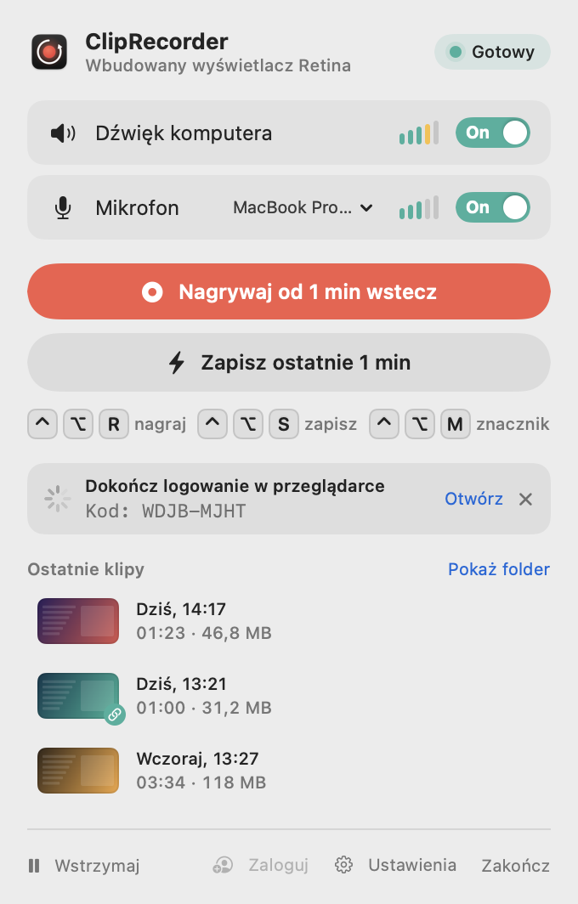
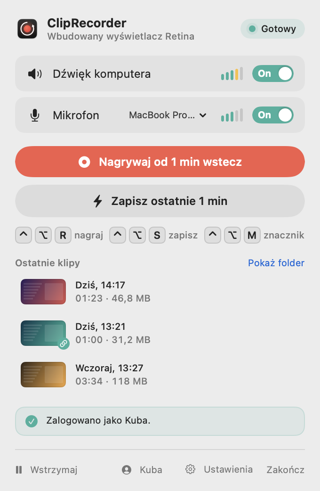
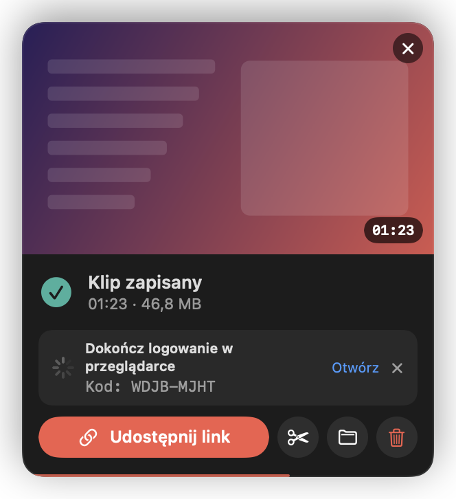
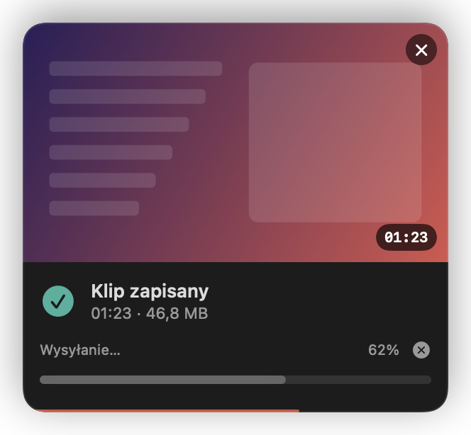
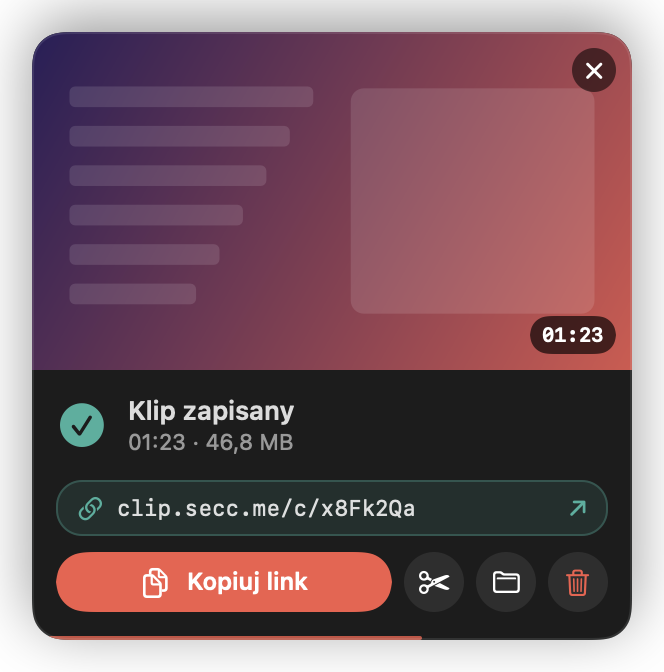
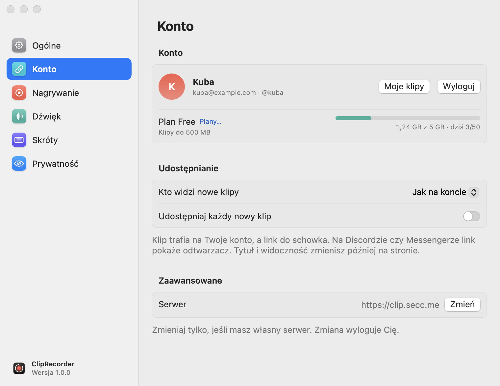

# Udostępnianie linkiem (clip.secc.me)

[← Spis treści](README.md)

Zamiast wysyłać plik możesz wysłać link. Klip trafia na Twoje konto na [clip.secc.me](https://clip.secc.me),
a link ląduje w schowku. Discord, Messenger, Slack czy iMessage pokażą pod linkiem odtwarzacz.

Udostępnianie jest **całkowicie opcjonalne**. Bez logowania ClipRecorder niczego nigdzie nie wysyła.

## Logowanie

Logujesz się w przeglądarce. Aplikacja nigdy nie widzi Twojego hasła.

1. Kliknij **Zaloguj** w stopce popovera albo *Ustawienia → Konto → Zaloguj się*.
   Jeśli nie masz konta, wybierz **Załóż konto…**.
2. Otworzy się przeglądarka z kodem, a popover pokaże ten sam kod:

<picture>
  <source media="(prefers-color-scheme: dark)" srcset="screenshots/popover-login-dark.png">
  
</picture>

3. Sprawdź, czy kody się zgadzają, i kliknij na stronie **Zezwól i połącz**. Po chwili popover pokaże Twoją nazwę.

<picture>
  <source media="(prefers-color-scheme: dark)" srcset="screenshots/popover-signed-in-dark.png">
  
</picture>

Kliknięcie nazwy w stopce otwiera menu: *Moje klipy*, *Ustawienia konta…*, *Wyloguj*.

**Otwórz** otwiera stronę logowania ponownie, a **✕** anuluje logowanie. Na stronie, w *Moje klipy*, ten Mac
będzie widoczny jako „ClipRecorder – nazwa Twojego Maca” i możesz go tam w każdej chwili odłączyć.

Aplikacja dostaje token, który trzyma w **pęku kluczy macOS**. Przy wersjach budowanych ze źródeł macOS może po
każdej kompilacji zapytać, czy ClipRecorder może użyć tych danych. Wybierz **Zawsze pozwalaj**
([więcej](problemy.md#cliprecorder-chce-użyć-poufnych-informacji)).

## Udostępnianie klipu

Kliknij **Udostępnij link** na karcie po zapisie albo przy klipie na liście *Ostatnie klipy*.

1. Jeśli nie jesteś zalogowany, aplikacja najpierw uruchomi logowanie (karta pokaże kod), a zaraz po nim wyśle klip.

   

2. Aplikacja sprawdza limity konta, zanim zacznie cokolwiek wysyłać.
3. Klip jest konwertowany do **MP4 (H.264, do 1080p)** z jedną ścieżką dźwięku, czyli miksem. Taki plik zagra
   w każdej przeglądarce.
4. Plik idzie na serwer w częściach razem z miniaturą. Postęp widać na karcie i na liście, a wysyłanie można anulować.

5. Gotowe: link jest w schowku, a karta pokazuje go nad przyciskami.

- Kliknięcie pola z linkiem kopiuje go jeszcze raz, a ↗ otwiera go w przeglądarce.
- Przycisk zmienia się na **Kopiuj link**. Drugie udostępnienie tego samego klipu niczego już nie wysyła.
- Udostępnione klipy mają na liście zielony znaczek z łańcuchem.

## Udostępnianie automatyczne

*Ustawienia → Konto → Udostępniaj każdy nowy klip.* Każdy zapisany klip od razu idzie na serwer, a link trafia
do schowka. Przydaje się, gdy i tak zawsze wysyłasz klipy znajomym.

## Kto widzi klip

*Ustawienia → Konto → Kto widzi nowe klipy:*

| Opcja | Znaczenie |
|---|---|
| Jak na koncie | domyślna widoczność ustawiona na stronie |
| Publiczne | widoczne dla wszystkich |
| Tylko z linkiem | obejrzy je tylko ktoś, kto ma link |
| Prywatne | tylko Ty, po zalogowaniu |

Tytuł i widoczność pojedynczego klipu zmienisz później na stronie w *Moje klipy*.

## Konto i limity

<picture>
  <source media="(prefers-color-scheme: dark)" srcset="screenshots/settings-account-dark.png">
  
</picture>

W *Ustawienia → Konto* widać:
- nazwę, e-mail i login;
- plan z linkiem **Plany…** do cennika;
- maksymalny rozmiar klipu;
- zajęte miejsce;
- liczbę dzisiejszych wysyłek.

Gdy limit nie pozwala na wysyłkę, aplikacja mówi to od razu, bez wysyłania:

- *Klip jest za duży na Twój plan (do 500 MB). Przytnij go.*
- *Dzisiejszy limit wysyłek (50) jest wykorzystany.*
- *Brak miejsca na koncie. Usuń stare klipy na stronie albo zmień plan.*

**Moje klipy** otwiera panel na stronie. **Wyloguj** usuwa token z pęku kluczy, unieważnia go na serwerze
i anuluje trwające wysyłki. Klipy na koncie zostają.

## Własny serwer

*Ustawienia → Konto → Zaawansowane → Serwer → Zmień.* Wpisz adres własnej instalacji (kod serwera to repozytorium
ClipProjectWeb). Zmiana serwera wylogowuje. **Przywróć https://clip.secc.me** wraca do domyślnego.

## Prywatność

- Wysyłane są **wyłącznie klipy, które sam udostępnisz** (przyciskiem albo przez udostępnianie automatyczne).
- Bufor w tle nigdy nie opuszcza Twojego Maca.
- Wysyłka przerwana w połowie jest sprzątana na serwerze. Jeśli się to nie uda od razu, aplikacja ponowi
  sprzątanie przy następnym połączeniu.
