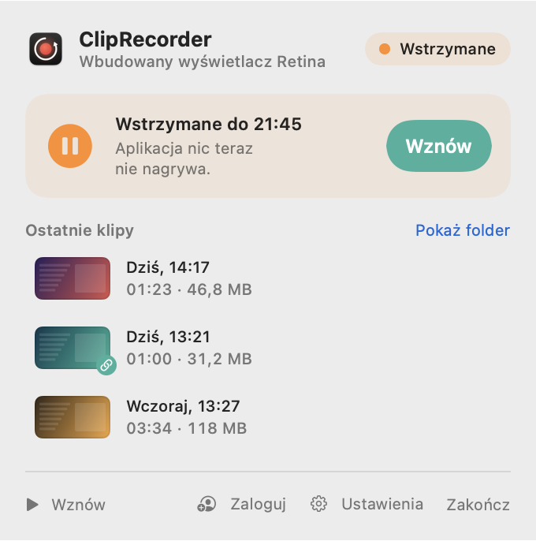
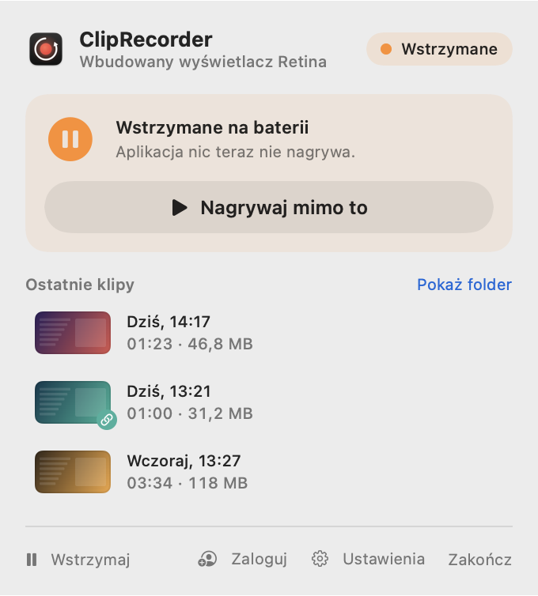

# Wstrzymywanie i oszczędzanie energii

[← Spis treści](README.md)

Bufor w tle to ciągłe kodowanie wideo. Na Apple Silicon zajmuje to zwykle kilka procent CPU, ale na baterii
albo przy prezentacji możesz chcieć, żeby aplikacja na chwilę przestała nagrywać.

## Ręczna pauza

Kliknij **Wstrzymaj** w stopce popovera (albo w [szybkim menu](pierwsze-kroki.md#szybkie-menu-prawy-klik-na-ikonie))
i wybierz czas:

- **Na 15 minut**
- **Na godzinę**
- **Do wznowienia**

<picture>
  <source media="(prefers-color-scheme: dark)" srcset="screenshots/popover-paused-timed-dark.png">
  
</picture>

Popover pokazuje, do kiedy trwa pauza. Po tym czasie nagrywanie w tle wznowi się samo. Pauza przetrwa ponowne
uruchomienie aplikacji. **Wznów** (na karcie albo w stopce) wznawia od razu.

Pauzy nie da się włączyć w trakcie nagrywania klipu, więc najpierw go zakończ. W czasie pauzy bufor jest pusty
i skróty zapisu nie mają czego zapisać.

## Automatycznie: bateria i tryb oszczędzania energii

W [Ustawieniach → Nagrywanie](ustawienia.md#nagrywanie):

| Opcja | Domyślnie | Działanie |
|---|---|---|
| Wstrzymuj na baterii | wyłączone | pauza, gdy MacBook nie jest podłączony do prądu |
| Wstrzymuj w trybie oszczędzania energii | **włączone** | pauza, gdy włączony jest tryb niskiego zużycia energii |

<picture>
  <source media="(prefers-color-scheme: dark)" srcset="screenshots/popover-paused-power-dark.png">
  
</picture>

- **Nagrywaj mimo to** wznawia nagrywanie do następnej zmiany zasilania, np. do podłączenia albo odłączenia ładowarki.
- Trwający klip **zawsze nagrywa się do końca**. Odłączenie ładowarki w połowie nagrania go nie przerwie.
  Pauza zacznie się dopiero po zapisaniu klipu.

## Blokada ekranu i uśpienie

Gdy zablokujesz Maca albo ekran się uśpi, nie ma czego nagrywać. Aplikacja sama przechodzi w stan
*Ekran zablokowany* i wraca do nagrywania zaraz po odblokowaniu. Nic nie trzeba robić.
