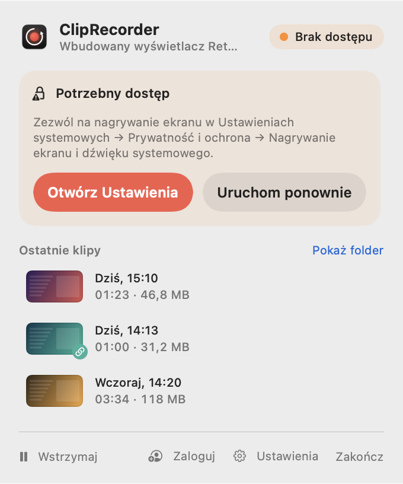
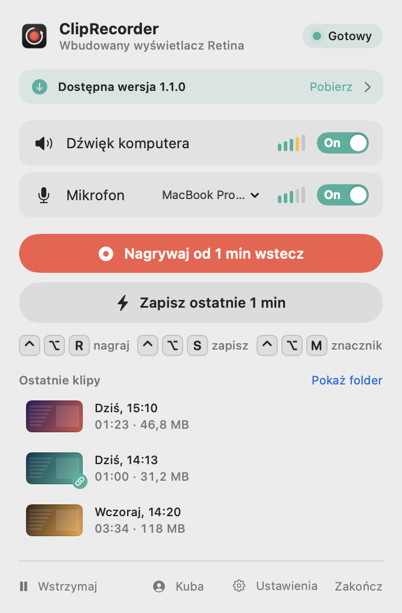

# Instalacja

[← Spis treści](README.md) · [🇬🇧 English](../../en/macos/installation.md)

## Wymagania

- macOS 15 Sequoia lub nowszy.
- Mac z Apple Silicon albo Intel ze sprzętowym enkoderem HEVC (praktycznie każdy Mac z ostatnich lat).
  Wydania są uniwersalne.
- Do budowania ze źródeł: Xcode albo same Command Line Tools (`xcode-select --install`).

## Gotowe wydanie (DMG)

1. Pobierz najnowszy plik `.dmg` z [Releases](https://github.com/ItsRaelx/ClipRecorder/releases).
2. Otwórz go i przeciągnij **ClipRecorder** do folderu **Aplikacje**.
3. Uruchom aplikację. Wydania testowe nie są podpisane certyfikatem Apple, więc za pierwszym razem macOS je zablokuje.
   Wejdź w *Ustawienia systemowe → Prywatność i ochrona* i kliknij **Otwórz mimo to**.

Każde pobrane wydanie ma obok plik `.sha256` z sumą kontrolną:

```sh
shasum -a 256 -c ClipRecorder-1.0.0.dmg.sha256
```

## Ze źródeł

```sh
git clone https://github.com/ItsRaelx/ClipRecorder.git
cd ClipRecorder/macos
./build.sh --install   # buduje, kopiuje do /Applications i uruchamia
```

Samo `./build.sh` tworzy `macos/build/ClipRecorder.app` bez instalowania. Wszystkie polecenia poniżej uruchamiasz
w folderze `macos/`.

### Podpis przy budowaniu

macOS wiąże uprawnienia do nagrywania ekranu z podpisem aplikacji. Żeby nie nadawać ich po każdym przebudowaniu,
`build.sh` przy pierwszym uruchomieniu tworzy w pęku kluczy *login* lokalny, samopodpisany certyfikat
**„ClipRecorder Local Signing”** i podpisuje nim aplikację. Certyfikat służy tylko do tego. Możesz go w każdej
chwili usunąć w aplikacji *Dostęp do pęku kluczy*.

```sh
SIGN_IDENTITY="Apple Development: Jan Kowalski (ABCDE12345)" ./build.sh --install  # własny certyfikat
SIGN_IDENTITY=- ./build.sh                                                          # ad-hoc: uprawnienia znikają po każdym buildzie
```

## Uprawnienia

Przy pierwszym uruchomieniu macOS zapyta o dwa uprawnienia:

| Uprawnienie | Po co |
|---|---|
| **Nagrywanie ekranu i dźwięku systemowego** | obraz i dźwięk komputera. Bez tego aplikacja nic nie nagra |
| **Mikrofon** | Twój głos. Bez tego klipy nagrają się bez mikrofonu |

Dopóki nie ma dostępu do ekranu, popover pokazuje kartę **Potrzebny dostęp**:

<picture>
  <source media="(prefers-color-scheme: dark)" srcset="screenshots/popover-permission-dark.png">
  
</picture>

- **Otwórz Ustawienia** przenosi prosto do właściwego miejsca w Ustawieniach systemowych.
- Gdy włączysz dostęp, karta sama zmieni się na **Dostęp nadany**. macOS wymaga ponownego uruchomienia aplikacji,
  więc wystarczy kliknąć **Uruchom ponownie**.

Skróty klawiszowe **nie** wymagają uprawnień Dostępności ani Monitorowania wejścia.

## Uruchamianie przy logowaniu

*Ustawienia → Ogólne → Uruchamiaj przy logowaniu.* Aplikacja pojawi się też w
*Ustawieniach systemowych → Ogólne → Rzeczy otwierane podczas logowania*.

## Aktualizacje

Raz dziennie aplikacja pyta publiczne API GitHuba o najnowsze wydanie. Gdy jest nowsze, w popoverze pojawia się baner:

<picture>
  <source media="(prefers-color-scheme: dark)" srcset="screenshots/popover-update-dark.png">
  
</picture>

**Pobierz** otwiera stronę wydania. Sprawdzanie wyłączysz w *Ustawienia → Ogólne → Sprawdzaj aktualizacje*.

## Odinstalowanie

1. Zakończ aplikację (popover → **Zakończ**).
2. Usuń `/Applications/ClipRecorder.app`.
3. Opcjonalnie posprzątaj:

```sh
rm -rf ~/Library/Caches/ClipRecorder                          # bufor na dysku (5 / 10 min)
defaults delete io.github.itsraelx.ClipRecorder               # ustawienia
tccutil reset ScreenCapture io.github.itsraelx.ClipRecorder   # uprawnienia
tccutil reset Microphone io.github.itsraelx.ClipRecorder
```

Klipy w `~/Movies/Clips` zostają. Jeśli byłeś zalogowany, wyloguj się przed usunięciem aplikacji.
Wylogowanie unieważnia token na serwerze i usuwa go z pęku kluczy.
