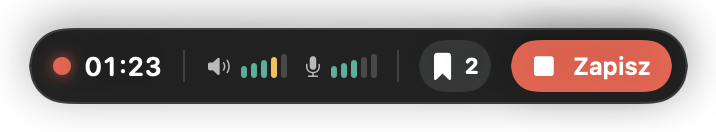
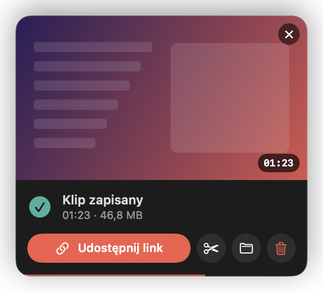
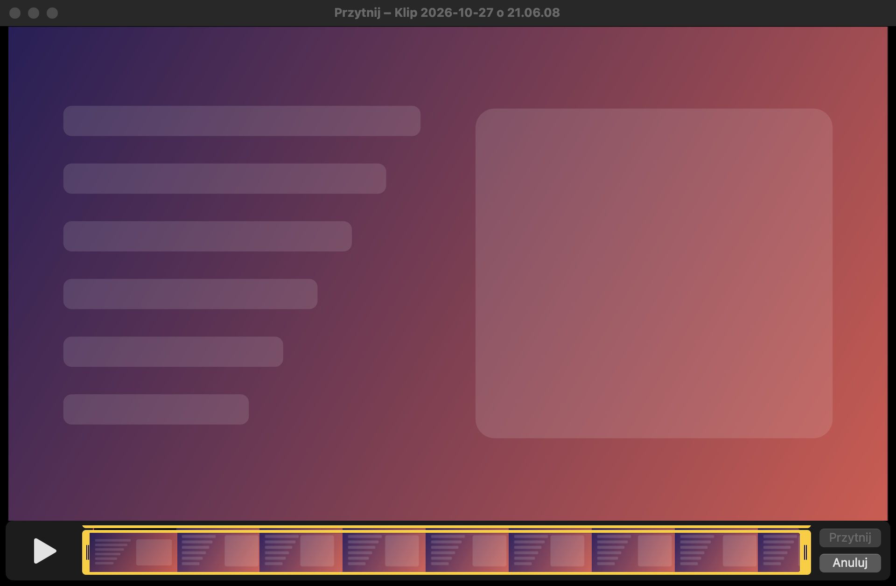

# Klipy

[← Spis treści](README.md) · [🇬🇧 English](../../en/macos/clips.md)

## Dwa sposoby zapisu

| | Zapisz ostatnie N | Nagrywaj od N wstecz |
|---|---|---|
| Skrót | <kbd>⌃</kbd><kbd>⌥</kbd><kbd>S</kbd> | <kbd>⌃</kbd><kbd>⌥</kbd><kbd>R</kbd> (drugie naciśnięcie kończy) |
| Co trafia do klipu | tylko bufor, czyli to, co już minęło | bufor + wszystko do momentu zatrzymania |
| Kiedy | „to było dobre, zapisz to” | „zaraz będzie coś ciekawego, nagrywaj dalej” |

Długość bufora (N) ustawiasz w [Ustawieniach → Nagrywanie](ustawienia.md#nagrywanie): 30 s, 1, 2, 5 albo 10 min.

Skróty działają w każdej aplikacji, także w grach i na pełnym ekranie. Te same akcje są w popoverze,
w [szybkim menu](pierwsze-kroki.md#szybkie-menu-prawy-klik-na-ikonie) i pod
[adresami automatyzacji](automatyzacja.md).

## Pasek nagrywania

W trakcie nagrywania u góry ekranu wysuwa się mały pasek:

- czas klipu;
- poziom dźwięku komputera i mikrofonu na żywo;
- przycisk z zakładką: dodaje znacznik i pokazuje, ile już ich jest;
- **Zapisz**: kończy klip.

Pasek, popover, karta podglądu i inne okna ClipRecordera **nigdy nie trafiają do nagrania**.

## Znaczniki

<kbd>⌃</kbd><kbd>⌥</kbd><kbd>M</kbd> (albo przycisk **Znacznik**) zaznacza ważny moment podczas nagrywania.
Każdy klip dostaje rozdziały:

| Rozdział | Gdzie |
|---|---|
| *Bufor* | początek klipu |
| *Start nagrywania* | moment naciśnięcia skrótu (tylko przy *Nagrywaj od N wstecz*) |
| *Znacznik 1*, *Znacznik 2*, … | Twoje znaczniki |

Rozdziały widać w QuickTime Playerze (*Widok → Pokaż rozdziały*), IINA, VLC i edytorach wideo, więc łatwo
przeskoczyć do ciekawego fragmentu.

## Podgląd po zapisie

Po zapisaniu klipu w prawym dolnym rogu ekranu wysuwa się karta:

- **Kliknij miniaturę**, żeby obejrzeć klip w domyślnym odtwarzaczu.
- **Przeciągnij miniaturę** do Discorda, Messengera, Slacka, Findera czy edytora wideo. Dostaną gotowy plik.
- **Udostępnij link** wysyła klip na clip.secc.me i kopiuje link ([więcej](udostepnianie.md)).
- ✂︎ przycina klip, a 📁 pokazuje go w Finderze.
- Kosz przenosi klip do Kosza systemowego.
- Karta znika sama po 8 sekundach (pasek na dole odlicza czas). Gdy najedziesz na nią myszą, odliczanie się zatrzymuje.
- **✕** zamyka ją od razu.

Kartę wyłączysz w *Ustawienia → Ogólne → Pokazuj podgląd po zapisie*.

## Ostatnie klipy

Popover pokazuje trzy najnowsze klipy. **Pokaż folder** otwiera cały folder w Finderze.

| Ikona przy miniaturze | Znaczenie |
|---|---|
| zielony łańcuch | klip ma już link na clip.secc.me |
| pasek postępu | klip jest właśnie wysyłany |

Najedź na wiersz, żeby zobaczyć szybkie akcje: link, przycinanie i menu **⋯**.
**Dwuklik** otwiera klip, a wiersz da się też **przeciągnąć** jak plik. Prawy klik i **⋯** pokazują pełne menu:

- Udostępnij link / Kopiuj link / Otwórz link (albo *Anuluj wysyłanie*);
- Otwórz, Pokaż w Finderze, Kopiuj plik;
- Przytnij…;
- Przenieś do Kosza.

## Przycinanie

Przycinanie działa jak w QuickTime Playerze:

1. Przeciągnij żółte uchwyty na początek i koniec fragmentu.
2. Kliknij **Przytnij**.

Klip jest przycinany **bez ponownego kodowania obrazu**, więc trwa to chwilę i nie traci jakości.
Plik zostaje nadpisany, a rozdziały i ścieżki dźwięku zostają na miejscu.

> Jeśli klip był już udostępniony linkiem, aplikacja „zapomina” ten link, bo na serwerze jest wersja przed
> przycięciem. Udostępnij go ponownie, żeby link pokazywał przyciętą wersję.

## Pliki

- Folder: `~/Movies/Clips`. Zmienisz go w [Ustawieniach → Ogólne](ustawienia.md#ogólne).
- Nazwa: `Klip 2026-10-27 o 21.06.08.mov`. Jeśli w tej samej sekundzie powstaną dwa klipy, drugi dostanie ` (2)`.
- Format: QuickTime `.mov`, obraz **HEVC (H.265)** kodowany sprzętowo, dźwięk AAC 48 kHz.
- Klip zapisuje się na bieżąco, w częściach co 5 sekund. Jeśli aplikacja albo system padnie w trakcie,
  wszystko do ostatniej części da się odtworzyć.
- Zamknięcie aplikacji w trakcie nagrywania najpierw kończy i zapisuje klip.

### Ścieżki dźwięku

Każdy klip ma do trzech ścieżek dźwięku:

1. **Miks (system + mikrofon)** – domyślna ścieżka, którą słyszy każdy odtwarzacz;
2. **Dźwięk systemu** – osobno, do montażu;
3. **Mikrofon** – osobno, do montażu.

Wszystkie trzy są w jednej grupie alternatywnej. Zwykły odtwarzacz gra więc tylko miks, bez podwójnego dźwięku,
a w VLC czy IINA możesz przełączyć się na pojedynczą ścieżkę. DaVinci Resolve, Final Cut Pro i Premiere Pro
widzą wszystkie ścieżki osobno. Głośność obu źródeł w miksie ustawisz w [Ustawieniach → Dźwięk](ustawienia.md#dźwięk).

### Miejsce na dysku

Przed zapisem aplikacja sprawdza wolne miejsce:

- poniżej **3 GB** ostrzega;
- poniżej **300 MB** odmawia zapisu, żeby nie zapchać dysku do zera.

Stare klipy może sama przenosić do Kosza, zależnie od wieku albo rozmiaru folderu
([Ustawienia → Ogólne](ustawienia.md#ogólne)).
