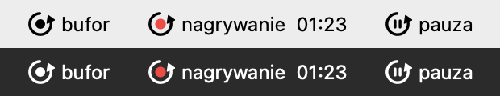
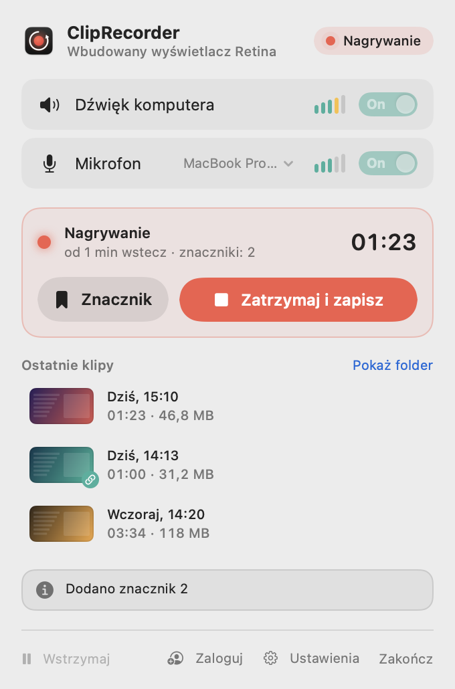

# Pierwsze kroki

[← Spis treści](README.md) · [🇬🇧 English](../../en/macos/getting-started.md)

## Jak działa bufor

Od uruchomienia ClipRecorder nagrywa w tle ekran, dźwięk komputera i mikrofon, ale **nic nie zapisuje**.
Trzyma tylko ostatnie N sekund (domyślnie 1 minutę) i na bieżąco nadpisuje starsze. Plik powstaje dopiero wtedy,
gdy naciśniesz skrót albo przycisk:

- **Zapisz ostatnie N** (<kbd>⌃</kbd><kbd>⌥</kbd><kbd>S</kbd>) zapisuje sam bufor, czyli to, co już minęło.
- **Nagrywaj od N wstecz** (<kbd>⌃</kbd><kbd>⌥</kbd><kbd>R</kbd>) zaczyna klip od bufora i nagrywa dalej,
  aż naciśniesz skrót drugi raz.

Bufor do 2 minut jest trzymany w pamięci, a 5 i 10 minut na dysku (`~/Library/Caches/ClipRecorder`). Szczegóły
znajdziesz w [Ustawieniach → Nagrywanie](ustawienia.md#nagrywanie).

## Ikona w pasku menu

| Ikona | Znaczenie |
|---|---|
| kółko ze strzałką | bufor działa, gotowe do zapisu |
| czerwona kropka i licznik czasu | trwa nagrywanie klipu |
| kółko z pauzą | nagrywanie w tle jest wstrzymane ([więcej](wstrzymywanie.md)) |
| wykrzyknik | brak uprawnień do nagrywania ekranu |

Po najechaniu myszą podpowiedź pokazuje aktualny stan, np. *ClipRecorder – gotowy, pamięta ostatnie 1 min*.

- **Lewy klik** otwiera popover.
- **Prawy klik** (albo <kbd>⌃</kbd>-klik) otwiera szybkie menu.

## Popover

<picture>
  <source media="(prefers-color-scheme: dark)" srcset="screenshots/popover-idle-dark.png">
  
</picture>

Od góry:

1. **Nagłówek:** co jest nagrywane (ekran albo okno aplikacji) i stan: *Gotowy*, *Nagrywanie*, *Wstrzymane*,
   *Brak dostępu* albo *Uruchamianie…*.
2. **Źródła dźwięku:**
   - **Dźwięk komputera** i **Mikrofon** włączasz i wyłączasz przyciskami *On/Off*;
   - paski obok pokazują poziom na żywo;
   - przy mikrofonie jest menu wyboru urządzenia.

   Jeśli wybrany mikrofon to słuchawki Bluetooth, pojawi się ostrzeżenie. Takie słuchawki przełączają się wtedy
   w tryb rozmowy i muzyka gra gorzej.
3. **Przyciski główne:** *Nagrywaj od N wstecz* i *Zapisz ostatnie N*, a pod nimi przypomnienie skrótów.
4. **Ostatnie klipy:** trzy najnowsze klipy z miniaturą, datą, długością i rozmiarem ([więcej](klipy.md#ostatnie-klipy)).
5. **Komunikaty:** krótkie potwierdzenia, np. *Dodano znacznik 2* albo *Link skopiowany*.
6. **Stopka:**
   - **Wstrzymaj** (menu z czasem pauzy);
   - konto: **Zaloguj** albo Twoja nazwa;
   - **Ustawienia**;
   - **Zakończ**.

W trakcie nagrywania zamiast przycisków głównych widać kartę nagrywania z czasem, liczbą znaczników
i przyciskami **Znacznik** oraz **Zatrzymaj i zapisz**:

<picture>
  <source media="(prefers-color-scheme: dark)" srcset="screenshots/popover-recording-dark.png">
  
</picture>

Źródeł dźwięku nie da się zmienić w trakcie klipu, więc są wtedy wyszarzone.

## Szybkie menu (prawy klik na ikonie)

Najczęstsze akcje bez otwierania popovera:

| Pozycja | Kiedy |
|---|---|
| Nagrywaj od N wstecz / Zapisz ostatnie N | gdy bufor jest gotowy |
| Zatrzymaj i zapisz / Dodaj znacznik | w trakcie nagrywania |
| Otwórz ostatni klip | gdy jest jakiś klip |
| Pokaż folder z klipami | zawsze |
| Wstrzymaj ▸ Na 15 minut / Na godzinę / Do wznowienia | gdy nie nagrywasz klipu |
| Wznów nagrywanie w tle | gdy wstrzymałeś ręcznie |
| Ustawienia… / Zakończ ClipRecorder | zawsze |

## Pierwszy klip w 30 sekund

1. Uruchom aplikację i nadaj uprawnienia ([Instalacja → Uprawnienia](instalacja.md#uprawnienia)).
2. Pracuj normalnie. Bufor zbiera się w tle.
3. Naciśnij <kbd>⌃</kbd><kbd>⌥</kbd><kbd>S</kbd>. W prawym dolnym rogu pojawi się karta **Klip zapisany**.
4. Kliknij miniaturę, żeby obejrzeć klip, albo przeciągnij ją prosto do Discorda, Messengera czy Findera.
