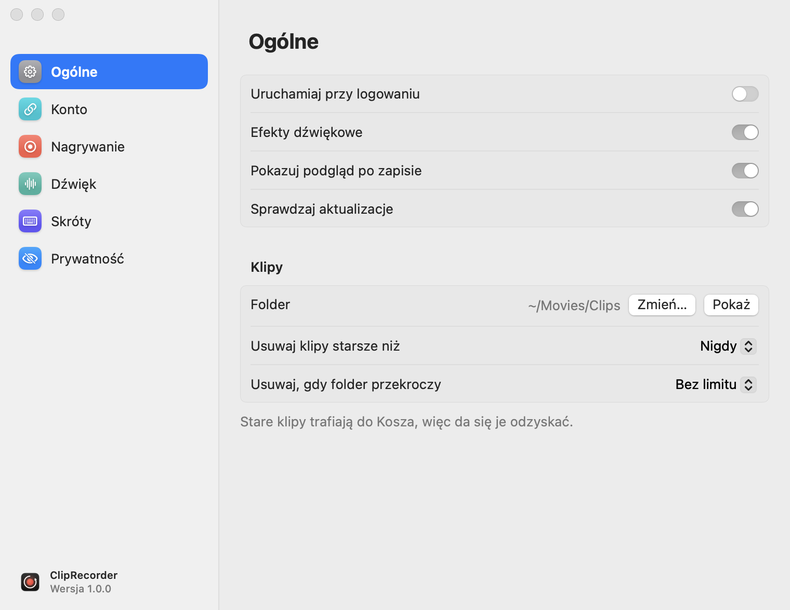
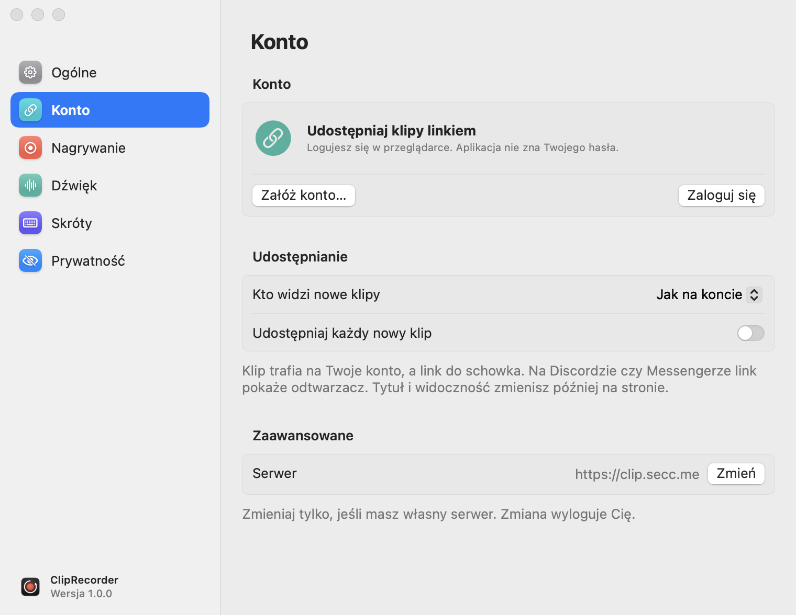
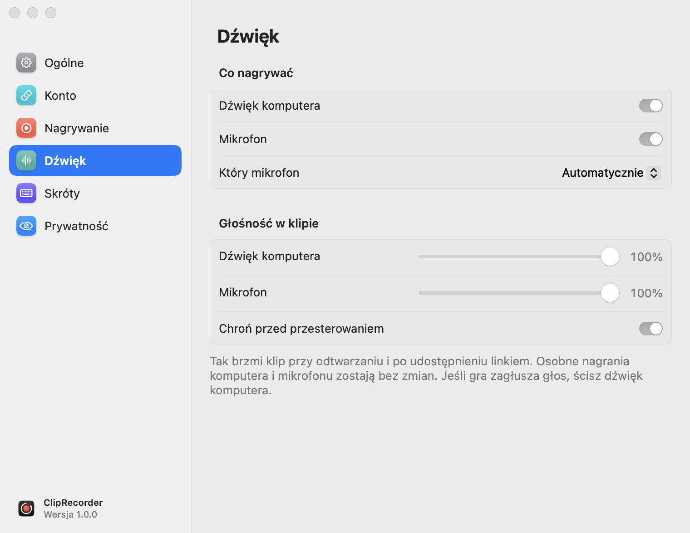
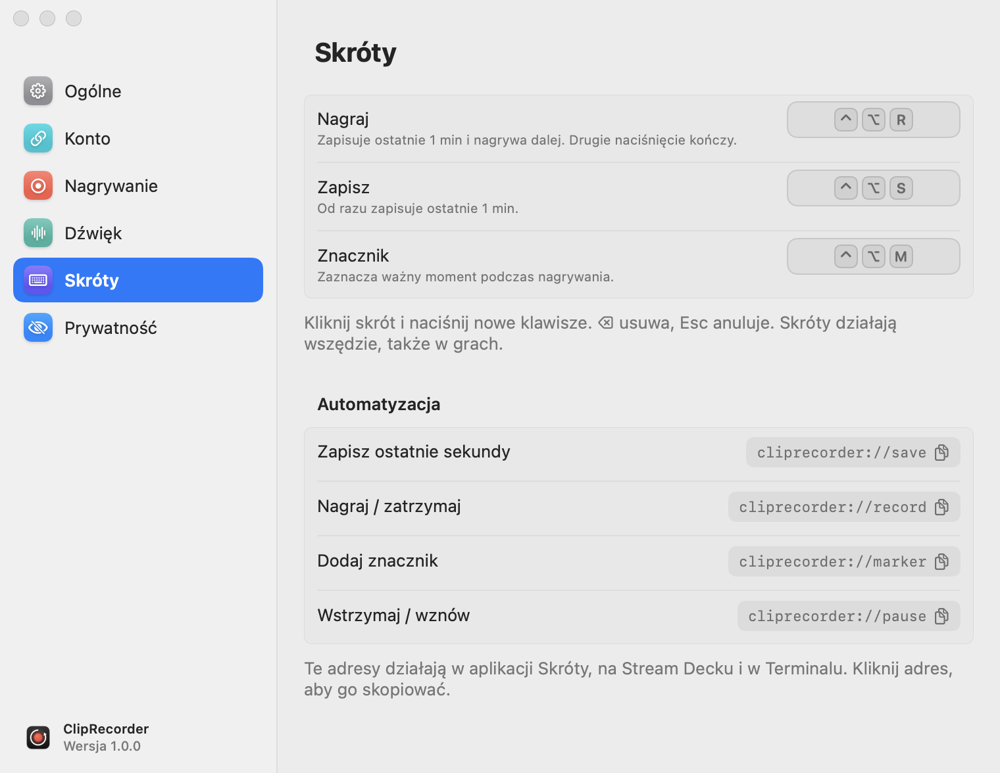
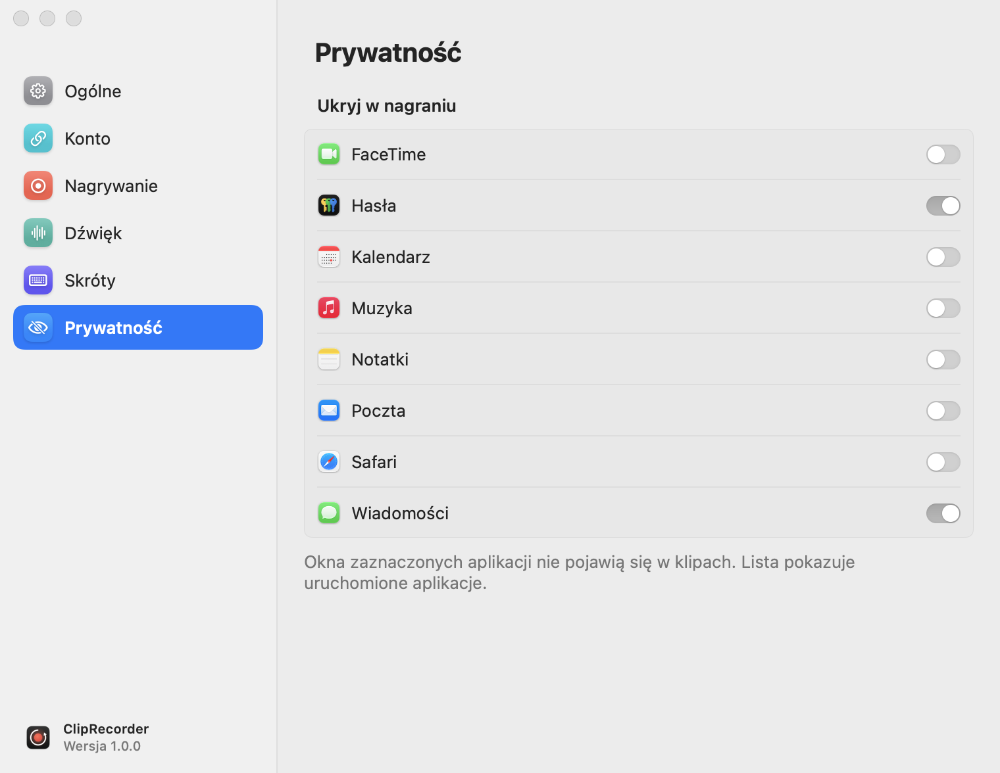

# Ustawienia

[← Spis treści](README.md) · [🇬🇧 English](../../en/macos/settings.md)

Okno ustawień otworzysz:
- przyciskiem **Ustawienia** w popoverze;
- z szybkiego menu (prawy klik na ikonie);
- adresem `cliprecorder://settings`.

Okno ma sześć sekcji. Zmiany działają od razu, bez przycisku „Zapisz”.

## Ogólne

<picture>
  <source media="(prefers-color-scheme: dark)" srcset="screenshots/settings-general-dark.png">
  
</picture>

| Opcja | Opis |
|---|---|
| Uruchamiaj przy logowaniu | aplikacja startuje razem z systemem |
| Efekty dźwiękowe | krótkie dźwięki przy starcie nagrywania, znaczniku, zapisie, udostępnieniu i błędach |
| Pokazuj podgląd po zapisie | karta „Klip zapisany” w rogu ekranu ([więcej](klipy.md#podgląd-po-zapisie)) |
| Sprawdzaj aktualizacje | raz dziennie pyta GitHuba o nową wersję |
| Folder | gdzie trafiają klipy (domyślnie `~/Movies/Clips`). **Zmień…** wybiera inny, **Pokaż** otwiera go w Finderze |
| Usuwaj klipy starsze niż | Nigdy / 7 / 30 / 90 dni |
| Usuwaj, gdy folder przekroczy | Bez limitu / 10 / 20 / 50 / 100 GB. Najpierw znikają najstarsze klipy |

Sprzątanie przenosi klipy do **Kosza**, więc da się je odzyskać. Dotyczy tylko plików nagranych przez ClipRecordera
(`Klip …`), a innych plików w folderze nie rusza.

## Konto

<picture>
  <source media="(prefers-color-scheme: dark)" srcset="screenshots/settings-account-signed-out-dark.png">
  
</picture>

| Opcja | Opis |
|---|---|
| Załóż konto… / Zaloguj się | logowanie w przeglądarce kodem ([więcej](udostepnianie.md#logowanie)) |
| Moje klipy / Wyloguj | po zalogowaniu: panel na stronie i wylogowanie |
| Plan, zajęte miejsce, wysyłki dziś | limity konta ([więcej](udostepnianie.md#konto-i-limity)) |
| Kto widzi nowe klipy | Jak na koncie / Publiczne / Tylko z linkiem / Prywatne |
| Udostępniaj każdy nowy klip | automatyczna wysyłka po każdym zapisie |
| Serwer | adres serwera, tylko dla własnej instalacji. Zmiana wylogowuje |

## Nagrywanie

<picture>
  <source media="(prefers-color-scheme: dark)" srcset="screenshots/settings-recording-dark.png">
  
</picture>

| Opcja | Wartości | Opis |
|---|---|---|
| Źródło | Główny ekran, konkretny monitor, Okno: *aplikacja* | przy oknie aplikacji nagrywane jest jej największe okno |
| Rozdzielczość | Pełna / 1440p / 1080p / 720p | „Pełna” to natywna rozdzielczość ekranu. Niższa oznacza mniejsze pliki i mniej pracy dla enkodera |
| Płynność | 30 / 60 fps | 60 fps dla gier i szybkiego ruchu |
| Jakość | Niska / Średnia / Wysoka | bitrate HEVC. Średnia wystarcza do większości zastosowań |
| Pamiętaj ostatnie | 30 s / 1 / 2 / 5 / 10 min | długość bufora |
| Wstrzymuj na baterii | | [więcej](wstrzymywanie.md#automatycznie-bateria-i-tryb-oszczędzania-energii) |
| Wstrzymuj w trybie oszczędzania energii | | j.w. |

Pod buforem aplikacja podaje, ile zajmuje minuta nagrania przy obecnych ustawieniach.

- Bufor do 2 minut jest trzymany **w pamięci**.
- 5 i 10 minut to ciągły zapis **na dysk** (`~/Library/Caches/ClipRecorder`), nadpisywany w kółko.
- Zmiana źródła, rozdzielczości, płynności albo jakości **kasuje bieżący bufor**, bo enkoder startuje od nowa.

## Dźwięk

<picture>
  <source media="(prefers-color-scheme: dark)" srcset="screenshots/settings-audio-dark.png">
  
</picture>

| Opcja | Opis |
|---|---|
| Dźwięk komputera | wszystko, co gra na Macu: gry, filmy, rozmowy |
| Mikrofon | Twój głos |
| Który mikrofon | **Automatycznie** albo konkretne urządzenie |
| Głośność w klipie: Dźwięk komputera / Mikrofon | proporcje w ścieżce *Miks* (0–100%) |
| Chroń przed przesterowaniem | ogranicznik, który ścisza nagłe głośne dźwięki w miksie |

**Automatycznie** bierze domyślny mikrofon systemu, ale omija mikrofony Bluetooth, gdy jest inny (wbudowany albo
na kablu). Nagrywanie z mikrofonu AirPods i innych słuchawek Bluetooth przełącza je w tryb rozmowy, przez co
muzyka i gra brzmią wtedy dużo gorzej.

Głośność dotyczy tylko ścieżki *Miks*. Osobne ścieżki *Dźwięk systemu* i *Mikrofon* zostają nietknięte
([więcej o ścieżkach](klipy.md#ścieżki-dźwięku)).

## Skróty

<picture>
  <source media="(prefers-color-scheme: dark)" srcset="screenshots/settings-shortcuts-dark.png">
  
</picture>

Kliknij pole skrótu i naciśnij nowe klawisze. <kbd>⌫</kbd> usuwa skrót, a <kbd>Esc</kbd> anuluje zmianę.
Podczas ustawiania pozostałe skróty są wyłączone, żeby przypadkiem nie zacząć nagrywania.

Zasady:
- skrót musi zawierać <kbd>⌃</kbd> albo <kbd>⌘</kbd>, albo jednocześnie <kbd>⌥</kbd><kbd>⇧</kbd>, żeby nie psuł
  pisania (np. <kbd>⌥</kbd><kbd>A</kbd> to „ą”);
- klawisze funkcyjne (<kbd>F1</kbd>–<kbd>F20</kbd>) mogą być same;
- jeden skrót może mieć tylko jedną akcję. Przypisanie go innej akcji zdejmuje go z poprzedniej;
- jeśli skrót jest zajęty przez inną aplikację, pojawi się napis **Zajęty przez inną aplikację**.

Sekcja **Automatyzacja** pod spodem pokazuje adresy do aplikacji Skróty, Stream Decka i skryptów.
Kliknięcie adresu kopiuje go ([więcej](automatyzacja.md)).

## Prywatność

<picture>
  <source media="(prefers-color-scheme: dark)" srcset="screenshots/settings-privacy-dark.png">
  
</picture>

**Ukryj w nagraniu:** okna zaznaczonych aplikacji nie pojawią się w klipach. W klipie widać to, co jest pod nimi.
Przydaje się dla menedżera haseł, komunikatorów czy poczty. Lista pokazuje uruchomione aplikacje oraz te, które
już ukryłeś. Aplikacja ukryta i uruchomiona później też będzie ukryta.

Okna samego ClipRecordera (popover, pasek nagrywania, karta podglądu, ustawienia) są ukryte zawsze.
